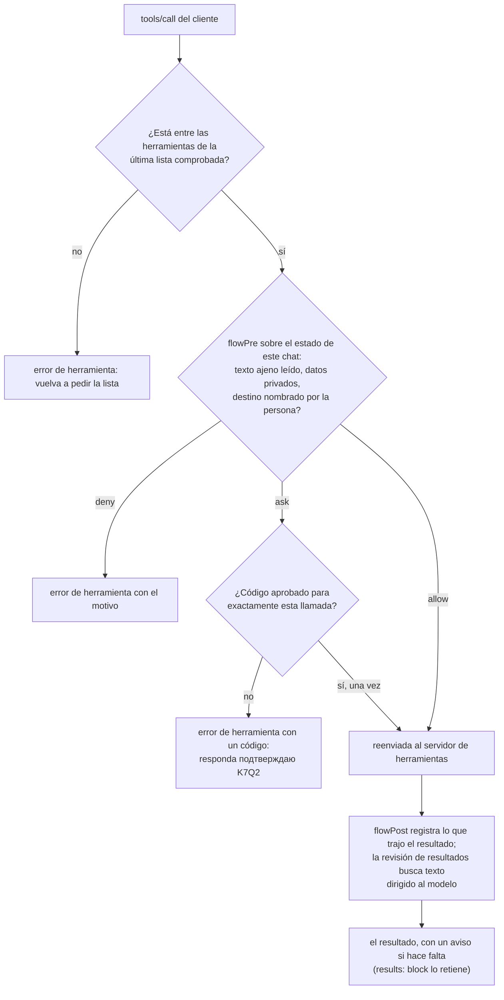
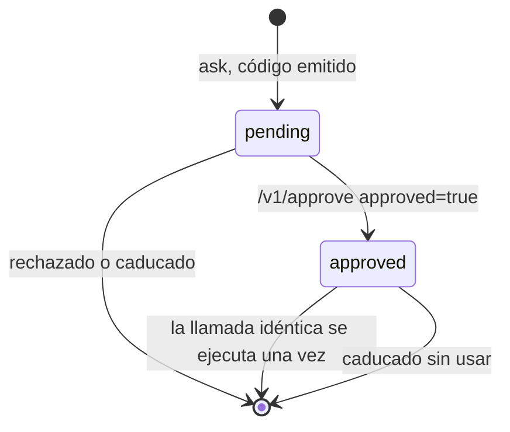

# Pasarela WARDEN: servidores de herramientas por HTTP y un servicio de decisiones

> 🌐 [English](gateway.md) · [Русский](gateway.ru.md) · **Español** · [Français](gateway.fr.md) · [中文](gateway.zh.md)

`warden-mcp wrap` protege un servidor MCP que el cliente arranca por stdio, y el [guardián de flujos](flow-guard.es.md)
(flow guard) llega a los agentes por sus hooks (Claude Code, [Codex](codex.es.md), [OpenCode](opencode.md)). Muchas
plataformas no tienen ni lo uno ni lo otro: OpenWebUI, n8n, servicios con LangChain y agentes escritos a mano llaman a
servidores de herramientas por HTTP y ejecutan algunas herramientas en su propio proceso. `warden-mcp gateway` los
cubre con un solo proceso:

| Ruta | Qué hace |
|---|---|
| `/mcp/<name>` | Proxy delante de un servidor MCP por Streamable HTTP |
| `/openapi/<name>/…` | Proxy delante de un servidor de herramientas OpenAPI (servidores de herramientas de OpenWebUI, `mcpo`) |
| `/v1/prompt`, `/v1/source`, `/v1/pre`, `/v1/post`, `/v1/approve` | Decisiones del guardián de flujos para lo que nunca pasa por un proxy |
| `/v1/health` | Sin token: si está viva y la versión; con token, también servidores y modo |

No hay reglas nuevas. Los proxies usan las comprobaciones de `wrap` (compuertas de definiciones de herramientas,
fijación con `vetAndPin`, revisión de resultados), y cada decisión es del guardián de flujos (`flowPre`, `flowPost`,
`flowPrompt`) sobre un estado por chat. El proxy y el servicio de decisiones corren en un solo proceso, así que una
página que el chat leyó con la búsqueda web cuenta para el envío que el modelo haga después por un servidor MCP.



**Estado (2026-11-17): en WARDEN 0.30.0.** Pruebas unitarias (37 de la pasarela, 24
del adaptador Python) y comprobaciones en vivo con OpenWebUI v0.11.4 (`scripts/openwebui-live-check.sh`, resultados en
[docs/openwebui.es.md](openwebui.es.md#comprobación-en-vivo)). El piloto de dos semanas en `audit` aún no se ha hecho.

## Arranque

```bash
export WARDEN_GATEWAY_TOKEN="$(openssl rand -hex 24)"
export WARDEN_APPROVE_TOKEN="$(openssl rand -hex 24)"
warden-mcp gateway --config gateway.json
```

```json
{
  "listen": { "host": "127.0.0.1", "port": 8787 },
  "approveTokenEnv": "WARDEN_APPROVE_TOKEN",
  "stateDir": "/var/lib/warden-gateway",
  "servers": [
    { "name": "crm", "type": "mcp-http", "url": "http://crm-mcp:8000/mcp", "headers": { "Authorization": "Bearer ${CRM_KEY}" } },
    { "name": "tools", "type": "openapi", "url": "http://mcpo:8000/" }
  ]
}
```

| Campo | Por defecto | Significado |
|---|---|---|
| `listen.host`, `listen.port` | `127.0.0.1`, `8787` | Dónde escucha la pasarela. Una dirección local o una red interna de Docker, nunca una pública |
| `tokenEnv` | `WARDEN_GATEWAY_TOKEN` | Variable con el token bearer que envían los clientes. Sin uno de 24 caracteres o más la pasarela no arranca |
| `approveTokenEnv` | — | Segundo token opcional, válido solo en `/v1/approve`. Se le da al adaptador, nunca a una conexión de herramientas |
| `chatHeader`, `userHeader` | `X-OpenWebUI-Chat-Id`, `X-OpenWebUI-User-Id` | Cabeceras que nombran el chat y el usuario en las llamadas por proxy |
| `servers[].headers` | — | Se envían a ese servidor en cada petición. `${NAME}` se lee del entorno; el `Authorization` del cliente nunca se reenvía |
| `stateDir` | `~/.local/state/warden-gateway` | Fijaciones, observaciones, estado del guardián por chat y códigos de aprobación, aparte del plugin de Claude Code |
| `flowPolicy` | `<stateDir>/flow-policy.json` | La [política del guardián de flujos](flow-guard.es.md): `mode`, `labels`, `trustedSources`, `allowedDestinations`, … |
| `policy` | valores de WARDEN | Compuertas de definiciones de herramientas, como `wrap --policy` |
| `results` | `warn` | Revisión de resultados: `warn` antepone un aviso al texto dirigido al modelo, `block` lo retiene, `off` |
| `approvePhrase` | `подтверждаю` | La palabra antes del código de aprobación (`approve` se acepta siempre) |
| `approvalTtlSeconds` | `600` | Cuánto vale un código |
| `retentionDays` | `30` | Plazo de conservación del estado del chat. Mientras el estado existe, el texto ajeno no «caduca», y un chat cuyo estado se borró cuenta al volver como lector de texto ajeno |
| `maxBodyBytes`, `upstreamTimeoutMs` | 4 MiB, 120 s | Límites por petición y por llamada a un servidor de herramientas |
| `requireAdapter` | `true` | Un chat del que el adaptador de la plataforma nunca informó un mensaje cuenta como lector de texto ajeno. Ponga `false` para un cliente que usa los proxies sin adaptador (n8n, LangChain); sus aprobaciones van entonces a `/v1/approve` desde el código del operador |

Los campos desconocidos detienen el arranque, como en `wrap --policy`. En ejecución, solo módulos internos de Node.

## Proxies

**MCP por Streamable HTTP.** La pasarela responde `tools/list` ella misma: lee todas las páginas del servidor, pasa
las compuertas y la fijación y devuelve solo las herramientas que el veredicto permite. Una definición cambiada bloquea
la lista hasta que una persona la revise (`WARDEN_STATE_DIR=<stateDir> warden-mcp pins status|approve --id
gateway:<name>`), y nada de lo que cualquier sesión vio antes sigue siendo invocable. Una lista bloqueada se responde
como lista vacía, no como error: OpenWebUI 0.11 hace fallar todo el mensaje ante un error de `tools/list`, y los demás
servidores del chat deben seguir funcionando.

`tools/call` va primero al servicio de decisiones; una llamada permitida se reenvía y su resultado se registra y se
revisa. `resources/read`, `prompts/get` y `completion/complete` se juzgan igual antes de enviarse (la URI de un recurso
puede sacar datos), y sus resultados se registran y se revisan; el aviso va en el contenido del recurso o en los
mensajes del prompt. Las respuestas vuelven como JSON o como flujo SSE, como las envió el servidor; las notificaciones
de progreso pasan al momento, la respuesta espera sus comprobaciones. `initialize`, otras notificaciones, los listados,
el flujo GET y `DELETE` pasan tal cual, como en `wrap`.

Qué es una respuesta se decide como la lee un cliente tolerante: lo es cualquier mensaje con `result` o `error`, diga lo
que diga su `method` (también `"method": null`), y los id se comparan como los compara el cliente MCP (`5` y `"5"` son el
mismo id). En cualquier respuesta del servidor solo llega al cliente la respuesta a su propia petición, junto con
peticiones y notificaciones; las demás respuestas, los lotes (batch) y los datos ilegibles se descartan, y
`last-event-id` no se reenvía, así que un resultado de herramienta reanudado o desviado no puede llegar sin revisar.
`tools/call` sin id se rechaza. Se acepta un solo mensaje JSON-RPC por petición.

**OpenAPI.** Cada operación del `openapi.json` del servidor es una herramienta con el nombre de su `operationId`,
comprobada y fijada como una herramienta MCP. La especificación se lee en cada llamada y se vuelve a comprobar si sus
bytes cambiaron, así que un servidor que cambia una descripción entre dos llamadas se comprueba antes de la segunda. La
especificación que recibe el cliente lista solo las operaciones permitidas y no tiene `servers` en ningún nivel, así que
las llamadas vuelven por la pasarela. Una llamada se asocia con su operación más específica (un segmento literal gana a
una plantilla; un empate se rechaza). Ruta, query y cuerpo JSON forman sus argumentos, y un nombre que aparece en dos de
ellos se rechaza. El servidor recibe el cuerpo que WARDEN juzgó, en forma RFC 8785: una clave repetida no puede
significar una cosa para WARDEN y otra para el servidor, y un entero de más de 15 cifras (que un número JSON no lleva
con exactitud) se rechaza; hay que enviarlo como cadena. Un código queda ligado a esa petición exacta (método, ruta,
query, cuerpo).

Para la política del guardián, cada herramienta es `mcp__<server>__<tool>`, así que las etiquetas se escriben igual que
para Claude Code.

## Una llamada rechazada

| Decisión | Proxy MCP | Proxy OpenAPI | `/v1/pre` |
|---|---|---|---|
| `allow` | reenviada | reenviada | `{"decision":"allow"}` |
| `deny` | error de herramienta con el motivo | HTTP 403 `{"detail": …}` | `{"decision":"deny","reason","message","refusal"}` |
| `ask` | error de herramienta con el motivo y un código | HTTP 403 con el código | lo mismo más `code` y `preview` |

El modelo lee el rechazo y debe decírselo a la persona. Para `ask` el texto dice: responda exactamente
`подтверждаю K7Q2`. El código es aleatorio, vale diez minutos, está ligado al chat, al usuario, a la herramienta y a un
hash de los argumentos exactos (RFC 8785), y sirve para una sola llamada. Los códigos son archivos en
`<stateDir>/gateway/approvals` (creación exclusiva; respuesta y consumo por renombrado), así que un reinicio los conserva
y varios procesos de la pasarela pueden compartir una carpeta de estado; los caducados, con la vista previa de
argumentos que guardan, se borran en la siguiente llamada o en la limpieza de cada seis horas. Solo `/v1/approve`
convierte un código en una autorización, y solo el adaptador de la plataforma llama a esa ruta, desde el propio mensaje
de la persona o desde el diálogo de confirmación de la plataforma. Un código en una página, un documento o la respuesta
del propio modelo no hace nada. Otros argumentos, otro chat o un segundo uso piden de nuevo.



Una llamada cuyo chat se desconoce (sin cabecera de chat) se juzga como hecha tras leer texto ajeno y se rechaza sin
código. La vista previa que ve la persona marca todo lo que acorta. Se rechazan las rutas con segmentos `.` o `..` o con
una barra invertida (tal cual o `%5c`).

## Servicio de decisiones

Todas las rutas reciben JSON con `chat_id` y `user_id`, y exigen `Authorization: Bearer <token>`.

| Ruta | Cuerpo | Llama a |
|---|---|---|
| `POST /v1/prompt` | `prompt` | `flowPrompt`: las palabras de la persona y los destinos que nombra. Devuelve `first: true` si la pasarela no tenía estado del chat |
| `POST /v1/source` | `kind` (`web_search`, `url`, `document`, `file`, `knowledge`, `other`), `url`, `query`, `name`, `text` | `flowPost` sobre un lector: el chat contiene ahora texto ajeno |
| `POST /v1/pre` | `server`, `tool_name`, `tool_input` | `flowPre` y luego la lógica de códigos de aprobación. `server: "builtin"` son las herramientas propias de la plataforma: `search_web` / `fetch_url` pasan a ser `WebSearch` / `WebFetch`, el resto `mcp__owui__<tool>` |
| `POST /v1/post` | `server`, `tool_name`, `tool_input`, `tool_response`, `tool_error` | `flowPost` y revisión de resultados: `notice`, `flowNote`, `withhold` |
| `POST /v1/approve` | `code`, `approved`, `peek` | registra la respuesta de la persona (`peek: true` solo devuelve la herramienta y la vista previa); exige el token de aprobación si está configurado |

Los modos son los de la política del guardián: `audit` deja pasar todo y registra lo que `deny` rechazaría, `ask`
rechaza con un código, `deny` rechaza sin él, `off`. Empiece en `audit`. En `audit` la respuesta de `/v1/pre` incluye
además `wouldRefuse` con el motivo que daría `deny` (desde 0.31.0), y la línea del registro también.

## Registros y etiquetas

Las decisiones van a los registros por chat en `<stateDir>/claude-code/flow/*.log`, las mismas líneas JSON que escribe
el plugin de Claude Code, más un evento `gateway` con `chat_id`, `user_id`, herramienta, decisión, motivo y resolución.
Ni los argumentos ni los resultados se registran. `node scripts/flow-log-stats.mjs <stateDir>` los cuenta; en `audit`
muestra lo que `deny` habría rechazado.

`warden-mcp gateway labels --config gateway.json` lista las herramientas que los chats usaron sin etiqueta del
operador, con la estimación del guardián y un bloque `labels` para corregir y pegar en la política. Una herramienta sin
etiqueta se trata como herramienta MCP desconocida: su resultado es texto ajeno, y cuenta como envío cuando su nombre o
sus argumentos lo indican.

## Despliegue

- Mantenga la pasarela y los servidores de herramientas en una red privada. Los servidores de herramientas deben ser
  accesibles **solo** a través de la pasarela; si no, un cliente puede rodearla.
- Dé las claves de los servidores de herramientas a la pasarela (`servers[].headers` con `${ENV}`), no a la plataforma.
- Un proceso de pasarela por instancia de la plataforma, o uno compartido para varias. Todo el estado son archivos en
  `stateDir` (estado del chat bajo un bloqueo de archivo, códigos de aprobación creados en exclusiva y consumidos por
  renombrado), así que varios procesos pueden compartirlo.

## Lo que no hace

- Solo ve lo que pasa por ella. Las herramientas que la plataforma ejecuta por sí misma (el intérprete de código de
  OpenWebUI, las herramientas integradas, funciones sin el guardián) quedan invisibles salvo que se envuelvan o se
  apaguen.
- No distingue la parte útil de un texto encontrado de la inyectada: tras una búsqueda web todo el chat cuenta como
  lector de texto ajeno.
- No comprueba la respuesta del modelo (`flowStop`); eso es una etapa posterior.
- Un administrador de la plataforma puede apagar el adaptador.
