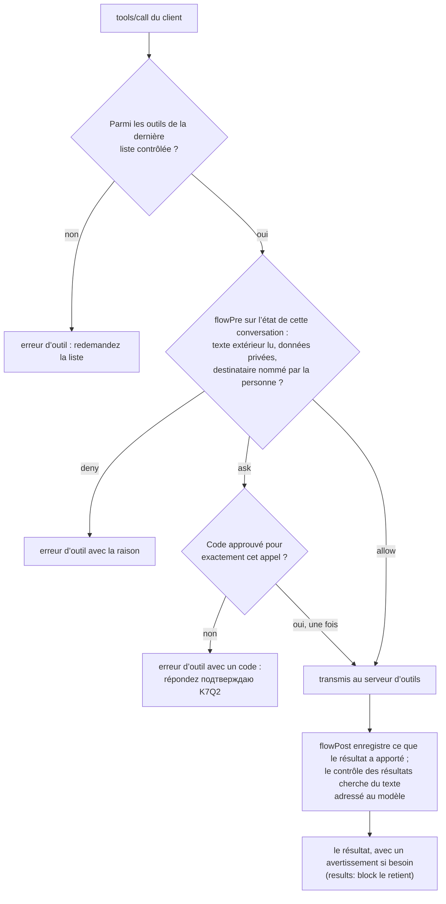
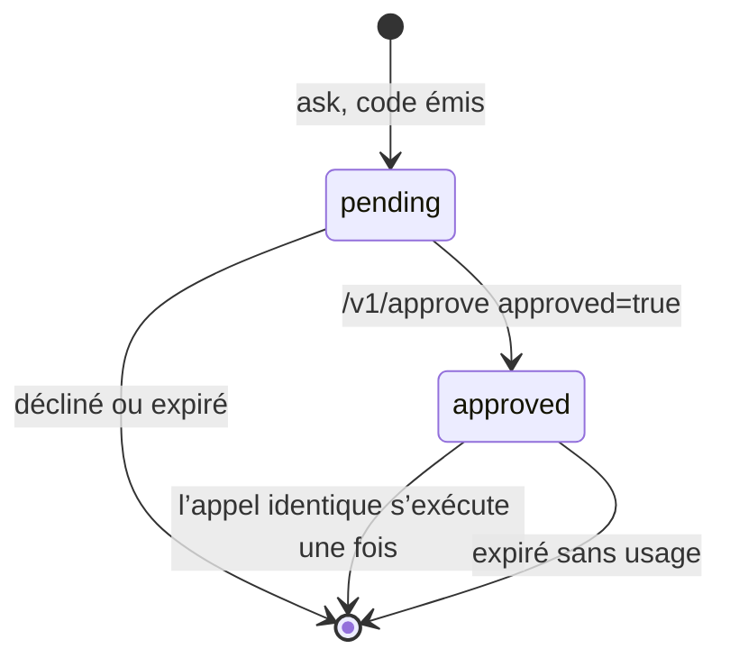

# Passerelle WARDEN : serveurs d’outils en HTTP et service de décision

> 🌐 [English](gateway.md) · [Русский](gateway.ru.md) · [Español](gateway.es.md) · **Français** · [中文](gateway.zh.md)

`warden-mcp wrap` protège un serveur MCP que le client lance en stdio, et le [garde de flux](flow-guard.fr.md) (flow
guard) atteint les agents par leurs hooks (Claude Code, [Codex](codex.fr.md), [OpenCode](opencode.md)). Beaucoup de
plateformes n’ont ni l’un ni l’autre : OpenWebUI, n8n, des services LangChain et des agents écrits à la main appellent
des serveurs d’outils en HTTP et exécutent certains outils dans leur propre processus. `warden-mcp gateway` les couvre
avec un seul processus :

| Route | Rôle |
|---|---|
| `/mcp/<name>` | Proxy devant un serveur MCP en Streamable HTTP |
| `/openapi/<name>/…` | Proxy devant un serveur d’outils OpenAPI (serveurs d’outils d’OpenWebUI, `mcpo`) |
| `/v1/prompt`, `/v1/source`, `/v1/pre`, `/v1/post`, `/v1/approve` | Décisions du garde de flux pour ce qui ne passe jamais par un proxy |
| `/v1/health` | Sans jeton : vivant et version ; avec le jeton, aussi les serveurs et le mode |

Il n’y a pas de nouvelles règles. Les proxys utilisent les contrôles de `wrap` (portes des définitions d’outils,
épinglage avec `vetAndPin`, contrôle des résultats), et chaque décision est celle du garde de flux (`flowPre`,
`flowPost`, `flowPrompt`) sur un état par conversation. Le proxy et le service de décision tournent dans un seul
processus : une page que la conversation a lue par la recherche web compte pour l’envoi que le modèle fait ensuite par
un serveur MCP.



**État (2026-11-17) : dans WARDEN 0.30.0.** Tests unitaires (37 pour la passerelle, 24
pour l’adaptateur Python) et vérifications en direct avec OpenWebUI v0.11.4 (`scripts/openwebui-live-check.sh`,
résultats dans [docs/openwebui.fr.md](openwebui.fr.md#vérification-en-direct)). Le pilote de deux semaines en `audit`
n’a pas encore eu lieu.

## Démarrage

```bash
export WARDEN_GATEWAY_TOKEN="$(openssl rand -hex 24)"
export WARDEN_APPROVE_TOKEN="$(openssl rand -hex 24)"
warden-mcp gateway --config gateway.json
```

```json
{
  "listen": { "host": "127.0.0.1", "port": 8787 },
  "approveTokenEnv": "WARDEN_APPROVE_TOKEN",
  "stateDir": "/var/lib/warden-gateway",
  "servers": [
    { "name": "crm", "type": "mcp-http", "url": "http://crm-mcp:8000/mcp", "headers": { "Authorization": "Bearer ${CRM_KEY}" } },
    { "name": "tools", "type": "openapi", "url": "http://mcpo:8000/" }
  ]
}
```

| Champ | Par défaut | Sens |
|---|---|---|
| `listen.host`, `listen.port` | `127.0.0.1`, `8787` | Où écoute la passerelle. Une adresse locale ou un réseau Docker interne, jamais une adresse publique |
| `tokenEnv` | `WARDEN_GATEWAY_TOKEN` | Variable qui contient le jeton bearer envoyé par les clients. Sans jeton de 24 caractères ou plus, la passerelle ne démarre pas |
| `approveTokenEnv` | — | Second jeton facultatif, accepté seulement sur `/v1/approve`. À donner à l’adaptateur, jamais à une connexion d’outils |
| `chatHeader`, `userHeader` | `X-OpenWebUI-Chat-Id`, `X-OpenWebUI-User-Id` | En-têtes qui nomment la conversation et l’utilisateur sur les appels par proxy |
| `servers[].headers` | — | Envoyés à ce serveur à chaque requête. `${NAME}` est lu dans l’environnement ; l’`Authorization` du client n’est jamais transmis |
| `stateDir` | `~/.local/state/warden-gateway` | Épinglages, observations, état du garde par conversation et codes d’approbation, à part du plugin Claude Code |
| `flowPolicy` | `<stateDir>/flow-policy.json` | La [politique du garde de flux](flow-guard.fr.md) : `mode`, `labels`, `trustedSources`, `allowedDestinations`, … |
| `policy` | valeurs de WARDEN | Portes des définitions d’outils, comme `wrap --policy` |
| `results` | `warn` | Contrôle des résultats : `warn` place un avertissement devant un texte adressé au modèle, `block` le retient, `off` |
| `approvePhrase` | `подтверждаю` | Le mot avant le code d’approbation (`approve` est toujours accepté aussi) |
| `approvalTtlSeconds` | `600` | Durée de validité d’un code |
| `retentionDays` | `30` | Durée de conservation de l’état d’une conversation. Tant que l’état existe, le texte extérieur ne « s’efface » pas, et une conversation dont l’état a été supprimé compte à son retour comme ayant lu du texte extérieur |
| `maxBodyBytes`, `upstreamTimeoutMs` | 4 Mio, 120 s | Limites par requête et par appel à un serveur d’outils |
| `requireAdapter` | `true` | Une conversation dont l’adaptateur de la plateforme n’a jamais signalé de message compte comme ayant lu du texte extérieur. Mettez `false` pour un client qui utilise les proxys sans adaptateur (n8n, LangChain) ; ses approbations passent alors par `/v1/approve` depuis le code de l’opérateur |

Les champs inconnus arrêtent le démarrage, comme dans `wrap --policy`. À l’exécution, seulement les modules intégrés de
Node.

## Proxys

**MCP en Streamable HTTP.** La passerelle répond elle-même à `tools/list` : elle lit toutes les pages du serveur, passe
les portes et l’épinglage et ne renvoie que les outils que le verdict autorise. Une définition modifiée bloque la liste
jusqu’à ce qu’une personne la relise (`WARDEN_STATE_DIR=<stateDir> warden-mcp pins status|approve --id
gateway:<name>`), et rien de ce qu’une session a vu avant ne reste appelable. Une liste bloquée est renvoyée vide, pas
en erreur : OpenWebUI 0.11 fait échouer tout le message sur une erreur de `tools/list`, et les autres serveurs de la
conversation doivent continuer à fonctionner.

`tools/call` passe d’abord par le service de décision ; un appel autorisé est transmis, son résultat enregistré et
contrôlé. `resources/read`, `prompts/get` et `completion/complete` sont jugés de la même façon avant l’envoi (l’URI
d’une ressource peut faire sortir des données), et leurs résultats sont enregistrés et contrôlés ; l’avertissement va
dans le contenu de la ressource ou dans les messages du prompt. Les réponses reviennent en JSON ou en flux SSE, comme le
serveur les a envoyées ; les notifications de progression passent tout de suite, la réponse attend ses contrôles.
`initialize`, les autres notifications, les listes, le flux GET et `DELETE` passent tels quels, comme dans `wrap`.

Ce qui est une réponse se décide comme le lit un client tolérant : tout message qui porte `result` ou `error` en est
une, quel que soit son `method` (`"method": null` compris), et les id se comparent comme le client MCP les compare (`5`
et `"5"` sont le même id). Dans toute réponse du serveur, seule la réponse à la requête du client lui parvient, avec les
requêtes et les notifications ; les autres réponses, les lots (batch) et les données illisibles sont écartés, et
`last-event-id` n’est pas transmis : un résultat d’outil repris ou mal routé ne peut pas arriver sans contrôle.
`tools/call` sans id est refusé. Un seul message JSON-RPC par requête est accepté.

**OpenAPI.** Chaque opération de l’`openapi.json` du serveur est un outil nommé par son `operationId`, contrôlé et
épinglé comme un outil MCP. La spécification est lue à chaque appel et contrôlée à nouveau si ses octets ont changé :
un serveur qui change une description entre deux appels est contrôlé avant le second. La spécification que reçoit le
client ne liste que les opérations autorisées et n’a de `servers` à aucun niveau, donc les appels reviennent par la
passerelle. Un appel est associé à son opération la plus précise (un segment littéral l’emporte sur un modèle ; une
égalité est refusée). Chemin, query et corps JSON forment ses arguments, et un nom présent à deux endroits est refusé.
Le serveur reçoit le corps que WARDEN a jugé, sous forme RFC 8785 : une clé répétée ne peut pas dire une chose à
WARDEN et une autre au serveur, et un entier de plus de 15 chiffres (qu’un nombre JSON ne porte pas exactement) est
refusé, à envoyer en chaîne. Un code est lié à cette requête exacte (méthode, chemin, query, corps).

Pour la politique du garde, chaque outil est `mcp__<server>__<tool>` : les étiquettes s’écrivent comme pour Claude
Code.

## Un appel refusé

| Décision | Proxy MCP | Proxy OpenAPI | `/v1/pre` |
|---|---|---|---|
| `allow` | transmis | transmis | `{"decision":"allow"}` |
| `deny` | erreur d’outil avec la raison | HTTP 403 `{"detail": …}` | `{"decision":"deny","reason","message","refusal"}` |
| `ask` | erreur d’outil avec la raison et un code | HTTP 403 avec le code | la même chose plus `code` et `preview` |

Le modèle lit le refus et doit le dire à la personne. Pour `ask`, le texte dit : répondez exactement
`подтверждаю K7Q2`. Le code est aléatoire, valable dix minutes, lié à la conversation, à l’utilisateur, à l’outil et à
un hachage des arguments exacts (RFC 8785), et vaut pour un seul appel. Les codes sont des fichiers dans
`<stateDir>/gateway/approvals` (création exclusive ; réponse et consommation par renommage) : un redémarrage les garde
et plusieurs processus de passerelle peuvent partager un dossier d’état ; les codes expirés, avec l’aperçu des
arguments qu’ils gardent, partent au prochain appel ou au nettoyage toutes les six heures. Seul `/v1/approve` fait d’un
code une autorisation, et seul l’adaptateur de la plateforme appelle cette route, depuis le propre message de la
personne ou depuis la boîte de dialogue de confirmation de la plateforme. Un code dans une page, un document ou la
réponse du modèle lui-même ne fait rien. D’autres arguments, une autre conversation ou un second usage posent une
nouvelle question.



Un appel dont la conversation est inconnue (pas d’en-tête de conversation) est jugé comme fait après du texte extérieur
et refusé sans code. L’aperçu que voit la personne signale tout ce qu’il raccourcit. Les chemins avec des segments `.`
ou `..` ou une barre oblique inverse (telle quelle ou `%5c`) sont refusés.

## Service de décision

Toutes les routes prennent du JSON avec `chat_id` et `user_id`, et exigent `Authorization: Bearer <token>`.

| Route | Corps | Appelle |
|---|---|---|
| `POST /v1/prompt` | `prompt` | `flowPrompt` : les propres mots de la personne et les destinataires qu’elle nomme. Renvoie `first: true` si la passerelle n’avait pas d’état pour la conversation |
| `POST /v1/source` | `kind` (`web_search`, `url`, `document`, `file`, `knowledge`, `other`), `url`, `query`, `name`, `text` | `flowPost` sur un lecteur : la conversation contient désormais du texte extérieur |
| `POST /v1/pre` | `server`, `tool_name`, `tool_input` | `flowPre`, puis la logique des codes d’approbation. `server: "builtin"` désigne les outils propres de la plateforme : `search_web` / `fetch_url` deviennent `WebSearch` / `WebFetch`, les autres `mcp__owui__<tool>` |
| `POST /v1/post` | `server`, `tool_name`, `tool_input`, `tool_response`, `tool_error` | `flowPost` et contrôle des résultats : `notice`, `flowNote`, `withhold` |
| `POST /v1/approve` | `code`, `approved`, `peek` | enregistre la réponse de la personne (`peek: true` renvoie seulement l’outil et l’aperçu) ; exige le jeton d’approbation s’il est configuré |

Les modes sont ceux de la politique du garde : `audit` laisse tout passer et journalise ce que `deny` refuserait, `ask`
refuse avec un code, `deny` refuse sans code, `off`. Commencez en `audit`. En `audit`, la réponse de `/v1/pre` porte
aussi `wouldRefuse` avec le motif que donnerait `deny` (depuis 0.31.0), tout comme la ligne de journal.

## Journaux et étiquettes

Les décisions vont dans les journaux par conversation `<stateDir>/claude-code/flow/*.log`, les mêmes lignes JSON que
celles du plugin Claude Code, plus un événement `gateway` avec `chat_id`, `user_id`, outil, décision, raison et issue.
Ni les arguments ni les résultats ne sont journalisés. `node scripts/flow-log-stats.mjs <stateDir>` les compte ; en
`audit` il montre ce que `deny` aurait refusé.

`warden-mcp gateway labels --config gateway.json` liste les outils que les conversations ont utilisés sans étiquette de
l’opérateur, avec l’estimation du garde et un bloc `labels` à corriger et à coller dans la politique. Un outil sans
étiquette est traité comme un outil MCP inconnu : son résultat est du texte extérieur, et il compte comme un envoi
quand son nom ou ses arguments le disent.

## Déploiement

- Gardez la passerelle et les serveurs d’outils sur un réseau privé. Les serveurs d’outils doivent être joignables
  **uniquement** par la passerelle, sinon un client peut la contourner.
- Donnez les clés des serveurs d’outils à la passerelle (`servers[].headers` avec `${ENV}`), pas à la plateforme.
- Un processus de passerelle par instance de la plateforme, ou un seul partagé pour plusieurs. Tout l’état tient dans
  des fichiers sous `stateDir` (état des conversations sous verrou de fichier, codes d’approbation créés en exclusivité
  et consommés par renommage), donc plusieurs processus peuvent le partager.

## Ce qu’elle ne fait pas

- Elle ne voit que ce qui passe par elle. Les outils que la plateforme exécute elle-même (l’interpréteur de code
  d’OpenWebUI, les outils intégrés, les fonctions sans le garde) restent invisibles tant qu’on ne les enveloppe pas ou
  qu’on ne les coupe pas.
- Elle ne distingue pas la partie utile d’un texte trouvé de la partie injectée : après une recherche web, toute la
  conversation compte comme ayant lu du texte extérieur.
- Elle ne vérifie pas la réponse du modèle (`flowStop`) ; c’est une étape ultérieure.
- Un administrateur de la plateforme peut couper l’adaptateur.
