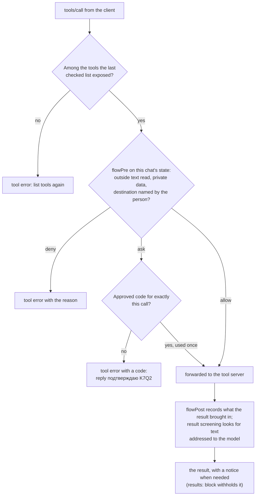
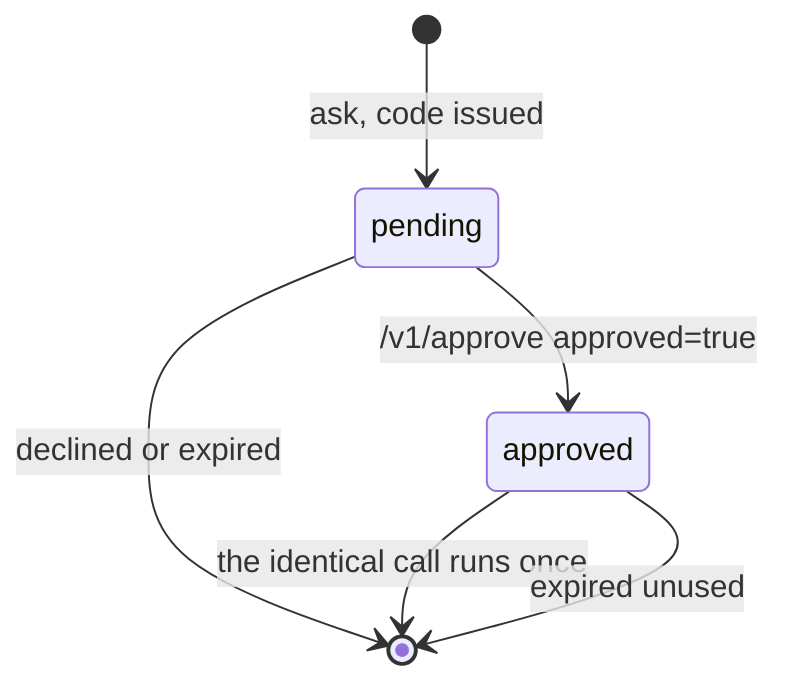

# WARDEN gateway: tool servers over HTTP and a decision service

> 🌐 **English** · [Русский](gateway.ru.md) · [Español](gateway.es.md) · [Français](gateway.fr.md) · [中文](gateway.zh.md)

`warden-mcp wrap` guards an MCP server a client starts over stdio, and the [flow guard](flow-guard.md) reaches agents
through their hooks (Claude Code, [Codex](codex.md), [OpenCode](opencode.md)). Many platforms have neither: OpenWebUI,
n8n, LangChain services and hand-written agents call tool servers over HTTP and run some tools in-process.
`warden-mcp gateway` covers them with one process:

| Route | What it does |
|---|---|
| `/mcp/<name>` | Proxy in front of an MCP server over Streamable HTTP |
| `/openapi/<name>/…` | Proxy in front of an OpenAPI tool server (OpenWebUI tool servers, `mcpo`) |
| `/v1/prompt`, `/v1/source`, `/v1/pre`, `/v1/post`, `/v1/approve` | Flow-guard decisions for what never passes a proxy |
| `/v1/health` | Liveness and version without a token; servers and mode with it |

There are no new rules. The proxies use the checks `wrap` uses (tool-definition gates, pinning with `vetAndPin`,
result screening), and every decision is the flow guard's (`flowPre`, `flowPost`, `flowPrompt`) on one state per chat.
The proxy and the decision service run in one process, so a page the chat read through web search taints a send the
model then makes through an MCP server.



**Status (2026-11-17): in WARDEN 0.30.0.** Unit tests (37 for the gateway, 24 for
the Python adapter) and live checks against OpenWebUI v0.11.4 (`scripts/openwebui-live-check.sh`, results in
[docs/openwebui.md](openwebui.md#live-check)). The two-week pilot in `audit` has not run yet.

## Start it

```bash
export WARDEN_GATEWAY_TOKEN="$(openssl rand -hex 24)"
export WARDEN_APPROVE_TOKEN="$(openssl rand -hex 24)"
warden-mcp gateway --config gateway.json
```

```json
{
  "listen": { "host": "127.0.0.1", "port": 8787 },
  "approveTokenEnv": "WARDEN_APPROVE_TOKEN",
  "stateDir": "/var/lib/warden-gateway",
  "servers": [
    { "name": "crm", "type": "mcp-http", "url": "http://crm-mcp:8000/mcp", "headers": { "Authorization": "Bearer ${CRM_KEY}" } },
    { "name": "tools", "type": "openapi", "url": "http://mcpo:8000/" }
  ]
}
```

| Field | Default | Meaning |
|---|---|---|
| `listen.host`, `listen.port` | `127.0.0.1`, `8787` | Where the gateway listens. Use a local or internal Docker address, never a public one |
| `tokenEnv` | `WARDEN_GATEWAY_TOKEN` | Variable holding the bearer token clients send. The gateway refuses to start without one of 24+ characters |
| `approveTokenEnv` | — | Optional second token, accepted only on `/v1/approve`. Give it to the adapter, never to a tool connection |
| `chatHeader`, `userHeader` | `X-OpenWebUI-Chat-Id`, `X-OpenWebUI-User-Id` | Request headers that name the chat and the user on proxied calls |
| `servers[].headers` | — | Sent to that server on every request. `${NAME}` is read from the environment; the client's own `Authorization` is never forwarded |
| `stateDir` | `~/.local/state/warden-gateway` | Pins, observations, per-chat flow state and approval codes, separate from the Claude Code plugin's |
| `flowPolicy` | `<stateDir>/flow-policy.json` | The [flow policy](flow-guard.md): `mode`, `labels`, `trustedSources`, `allowedDestinations`, … |
| `policy` | WARDEN defaults | Tool-definition gates, as `wrap --policy` |
| `results` | `warn` | Result screening: `warn` puts a notice in front of text that addresses the model, `block` withholds it, `off` |
| `approvePhrase` | `подтверждаю` | The word before an approval code (`approve` is always accepted too) |
| `approvalTtlSeconds` | `600` | How long a code stays valid |
| `retentionDays` | `30` | Chat state older than this is removed. Outside text never "wears off" while the state exists, and a removed chat that comes back counts as having read outside text |
| `maxBodyBytes`, `upstreamTimeoutMs` | 4 MiB, 120 s | Limits per request and per call to a tool server |
| `requireAdapter` | `true` | A chat the platform adapter never reported a message for counts as having read outside text. Set `false` for a client that uses the proxies without an adapter (n8n, LangChain); its approvals then go to `/v1/approve` from the operator's own code |

Unknown fields stop the start, as in `wrap --policy`. Node built-ins only at run time.

## Proxies

**MCP over Streamable HTTP.** The gateway answers `tools/list` itself: it reads every page from the server, runs the
gates and pinning, and returns only the tools the verdict allows. A changed definition blocks the list until a person
reviews it (`WARDEN_STATE_DIR=<stateDir> warden-mcp pins status|approve --id gateway:<name>`), and nothing any session
saw before stays callable. A blocked list is answered as an empty list, not an error: OpenWebUI 0.11 fails the whole
message on a `tools/list` error, and the chat's other servers should keep working.

`tools/call` goes to the decision service first; an allowed call is forwarded, its result recorded and screened.
`resources/read`, `prompts/get` and `completion/complete` are judged the same way before they are sent (a resource URI
can carry data out), and their results are recorded and screened; a notice goes into a resource's contents or a
prompt's messages. Answers come back as JSON or as an SSE stream, the way the server sent them; progress notifications
pass at once, the response waits for its checks. `initialize`, other notifications, listings, the GET stream and
`DELETE` pass through, as in `wrap`.

What counts as a response is decided the way a lenient client reads it: any message with `result` or `error` is one,
whatever its `method` says (`"method": null` included), and ids compare as the MCP client compares them (`5` and `"5"`
are one id). In any answer only the response to the client's own request reaches the client, with requests and
notifications; other responses, batches and unreadable data are dropped, and `last-event-id` is not forwarded, so a
resumed or misrouted tool result cannot arrive unscreened. `tools/call` without an id is refused. Only one JSON-RPC
message per request is accepted.

**OpenAPI.** Each operation of the server's `openapi.json` is a tool named by its `operationId`, checked and pinned
like an MCP tool. The spec is read on every call and checked again when its bytes changed, so a server that changes a
description between two calls is checked before the second one runs. The spec the client gets lists only allowed
operations and has no `servers` at any level, so calls come back through the gateway. A call is matched to its most
specific operation (a literal segment beats a template; an equal match is refused). Path, query and JSON body form its
arguments, and a name that appears in two of them is refused. The body the server receives is the one WARDEN judged,
written in RFC 8785 form: a repeated key cannot mean one thing to WARDEN and another to the server, and an integer
longer than 15 digits (which JSON numbers cannot carry exactly) is refused, to be sent as a string. A code is bound to
that exact request (method, path, query, body).

To the flow policy every tool is `mcp__<server>__<tool>`, so labels look the same as for Claude Code.

## A refused call

| Decision | MCP proxy | OpenAPI proxy | `/v1/pre` |
|---|---|---|---|
| `allow` | forwarded | forwarded | `{"decision":"allow"}` |
| `deny` | tool error with the reason | HTTP 403 `{"detail": …}` | `{"decision":"deny","reason","message","refusal"}` |
| `ask` | tool error with the reason and a code | HTTP 403 with the code | the same plus `code` and `preview` |

The model reads the refusal and should tell the person. For `ask` the text says: reply with exactly
`подтверждаю K7Q2`. The code is random, valid for ten minutes, bound to the chat, the user, the tool and a hash of the
exact arguments (RFC 8785), and good for one call. Codes are files under `<stateDir>/gateway/approvals` (exclusive
create, answered and consumed by rename), so a restart keeps them and several gateway processes can share one state
folder; expired ones, with the argument previews they keep, go at the next call or the six-hourly purge. Only
`/v1/approve` turns a code into a grant, and only the platform adapter calls that route, from the person's own message
or from the platform's confirmation dialog. A code in a page, a document or the model's own answer does nothing. Other
arguments, another chat or a second use get a new question.



A call whose chat is unknown (no chat header) is judged as made after outside text and refused without a code. The
preview a person sees marks everything it shortens. Paths with `.` or `..` segments or a backslash (raw or `%5c`) are
refused.

## Decision service

All routes take JSON with `chat_id` and `user_id`, and need `Authorization: Bearer <token>`.

| Route | Body | Calls |
|---|---|---|
| `POST /v1/prompt` | `prompt` | `flowPrompt`: the person's own words and the destinations they name. Answers `first: true` when the gateway had no state for the chat |
| `POST /v1/source` | `kind` (`web_search`, `url`, `document`, `file`, `knowledge`, `other`), `url`, `query`, `name`, `text` | `flowPost` on a reader: the chat now holds outside text |
| `POST /v1/pre` | `server`, `tool_name`, `tool_input` | `flowPre`, then the approval-code logic. `server: "builtin"` is the platform's own tools: `search_web` / `fetch_url` become `WebSearch` / `WebFetch`, the rest `mcp__owui__<tool>` |
| `POST /v1/post` | `server`, `tool_name`, `tool_input`, `tool_response`, `tool_error` | `flowPost` and result screening: `notice`, `flowNote`, `withhold` |
| `POST /v1/approve` | `code`, `approved`, `peek` | records the person's answer (`peek: true` only returns the tool and preview); needs the approve token when one is configured |

The modes are the flow policy's: `audit` lets every call run and logs what `deny` would refuse, `ask` refuses with a
code, `deny` refuses without one, `off`. Start in `audit`.

## Logs and labels

Decisions go to the per-chat logs under `<stateDir>/claude-code/flow/*.log`, the same JSON lines the Claude Code
plugin writes, plus a `gateway` event with `chat_id`, `user_id`, tool, decision, reason and resolution. Arguments and
results are not logged. `node scripts/flow-log-stats.mjs <stateDir>` counts them; in `audit` it shows what `deny`
would have refused.

`warden-mcp gateway labels --config gateway.json` lists the tools chats used without an operator label, with the
guard's guess and a `labels` block to correct and paste into the flow policy. A tool without a label is treated as an
unknown MCP tool: its result is outside text, and it counts as a send when its name or arguments say so.

## Deployment

- Keep the gateway and the tool servers on a private network. The tool servers must be reachable **only** through the
  gateway, or a client can go around it.
- Give the tool servers' keys to the gateway (`servers[].headers` with `${ENV}`), not to the platform.
- One gateway process per platform instance, or one shared gateway for several. All state is files under `stateDir`
  (chat state under a file lock, approval codes created exclusively and consumed by rename), so several processes may
  share it.

## What it does not do

- It sees only what passes it. Tools a platform runs itself (OpenWebUI's code interpreter, built-in tools, functions
  without the guard) are invisible unless wrapped or switched off.
- It does not tell the useful part of a found text from an injected one: after a web search the whole chat counts as
  having read outside text.
- It does not check the model's answer (`flowStop`); that is a later stage.
- A platform administrator can switch the adapter off.
