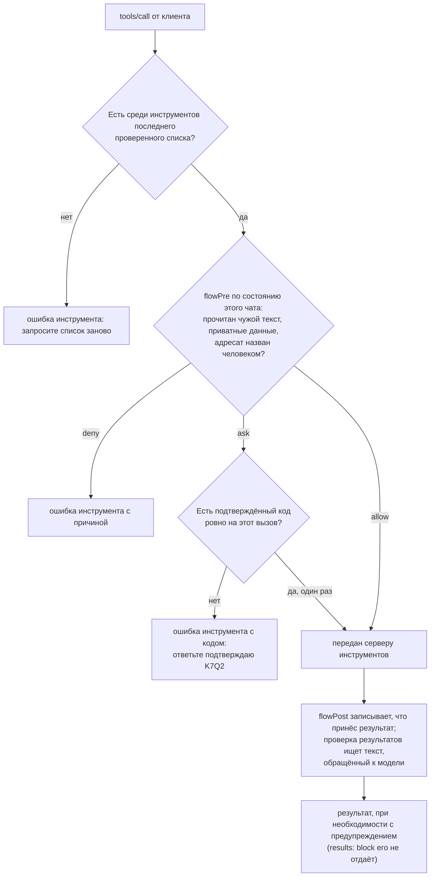
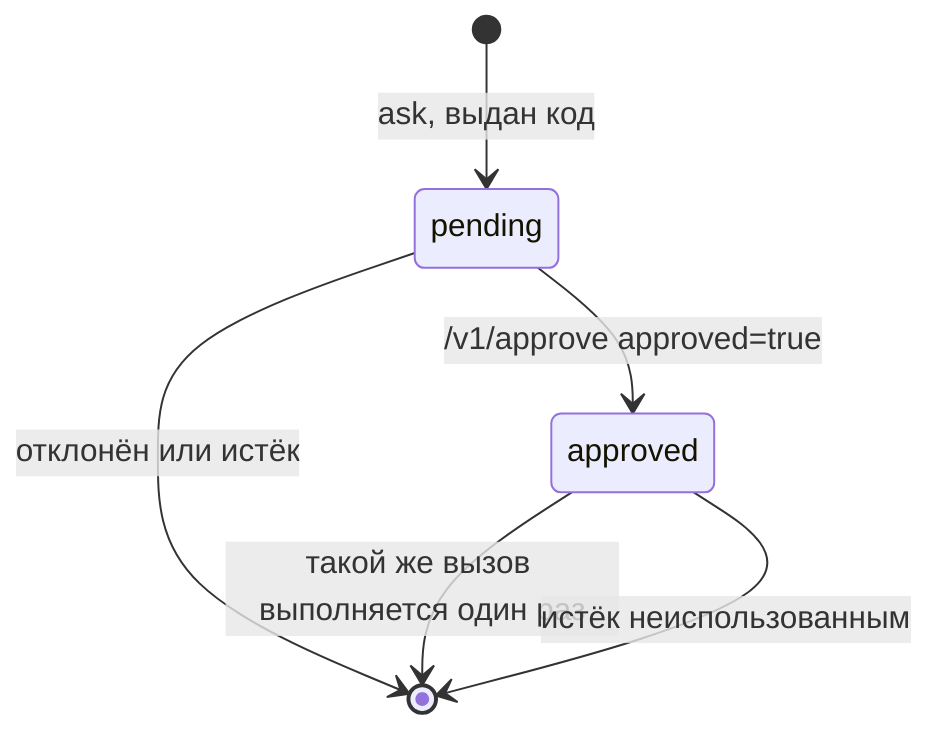

# Шлюз WARDEN: серверы инструментов по HTTP и служба решений

> 🌐 [English](gateway.md) · **Русский** · [Español](gateway.es.md) · [Français](gateway.fr.md) · [中文](gateway.zh.md)

`warden-mcp wrap` защищает MCP-сервер, который клиент запускает по stdio, а [страж потоков](flow-guard.ru.md) (flow
guard) встраивается в агентов через их хуки (Claude Code, [Codex](codex.ru.md), [OpenCode](opencode.md)). У многих
платформ нет ни того, ни другого: OpenWebUI, n8n, сервисы на LangChain и самописные агенты ходят к серверам
инструментов по HTTP и часть инструментов выполняют у себя внутри. Их закрывает один процесс, `warden-mcp gateway`:

| Путь | Что делает |
|---|---|
| `/mcp/<name>` | прокси перед MCP-сервером по Streamable HTTP |
| `/openapi/<name>/…` | прокси перед OpenAPI-сервером инструментов (серверы инструментов OpenWebUI, `mcpo`) |
| `/v1/prompt`, `/v1/source`, `/v1/pre`, `/v1/post`, `/v1/approve` | решения стража потоков для того, что не проходит через прокси |
| `/v1/health` | без токена — жив ли и версия; с токеном — ещё серверы и режим |

Новых правил нет. Прокси используют те же проверки, что `wrap` (гейты определений инструментов, закрепление через
`vetAndPin`, проверка результатов), а каждое решение принимает страж потоков (`flowPre`, `flowPost`, `flowPrompt`) по
одному состоянию на чат. Прокси и служба решений работают в одном процессе, поэтому страница, прочитанная через
веб-поиск, делает подозрительной отправку, которую модель потом делает через MCP-сервер.



**Состояние (2026-11-17): в WARDEN 0.30.0.** Юнит-тесты (37 у шлюза, 24 у
Python-адаптера) и живые проверки на OpenWebUI v0.11.4 (`scripts/openwebui-live-check.sh`, результаты в
[docs/openwebui.ru.md](openwebui.ru.md#живая-проверка)). Двухнедельный пилот в `audit` ещё не проводился.

## Запуск

```bash
export WARDEN_GATEWAY_TOKEN="$(openssl rand -hex 24)"
export WARDEN_APPROVE_TOKEN="$(openssl rand -hex 24)"
warden-mcp gateway --config gateway.json
```

```json
{
  "listen": { "host": "127.0.0.1", "port": 8787 },
  "approveTokenEnv": "WARDEN_APPROVE_TOKEN",
  "stateDir": "/var/lib/warden-gateway",
  "servers": [
    { "name": "crm", "type": "mcp-http", "url": "http://crm-mcp:8000/mcp", "headers": { "Authorization": "Bearer ${CRM_KEY}" } },
    { "name": "tools", "type": "openapi", "url": "http://mcpo:8000/" }
  ]
}
```

| Поле | По умолчанию | Значение |
|---|---|---|
| `listen.host`, `listen.port` | `127.0.0.1`, `8787` | где слушает шлюз. Локальный адрес или внутренняя сеть Docker, не публичный |
| `tokenEnv` | `WARDEN_GATEWAY_TOKEN` | переменная с токеном, который присылают клиенты. Без токена от 24 символов шлюз не стартует |
| `approveTokenEnv` | — | второй токен, только для `/v1/approve`. Его получает адаптер, но не подключение к инструментам |
| `chatHeader`, `userHeader` | `X-OpenWebUI-Chat-Id`, `X-OpenWebUI-User-Id` | заголовки запроса, по которым шлюз узнаёт чат и пользователя на проксируемых вызовах |
| `servers[].headers` | — | отправляются этому серверу в каждом запросе. `${NAME}` берётся из окружения; собственный `Authorization` клиента дальше не передаётся |
| `stateDir` | `~/.local/state/warden-gateway` | закрепления, наблюдения, состояние стража по чатам и коды подтверждения, отдельно от плагина Claude Code |
| `flowPolicy` | `<stateDir>/flow-policy.json` | [политика стража потоков](flow-guard.ru.md): `mode`, `labels`, `trustedSources`, `allowedDestinations`, … |
| `policy` | по умолчанию WARDEN | гейты определений инструментов, как `wrap --policy` |
| `results` | `warn` | проверка результатов: `warn` ставит предупреждение перед текстом, обращённым к модели, `block` не отдаёт его, `off` |
| `approvePhrase` | `подтверждаю` | слово перед кодом подтверждения (`approve` принимается всегда) |
| `approvalTtlSeconds` | `600` | сколько действует код |
| `retentionDays` | `30` | срок хранения состояния чата. Пока состояние есть, чужой текст «не выветривается», а чат, чьё состояние удалено, по возвращении считается прочитавшим чужой текст |
| `maxBodyBytes`, `upstreamTimeoutMs` | 4 МиБ, 120 с | ограничения на запрос и на вызов сервера инструментов |
| `requireAdapter` | `true` | чат, о сообщениях которого адаптер платформы ни разу не сообщил, считается прочитавшим чужой текст. Поставьте `false` для клиента, который ходит через прокси без адаптера (n8n, LangChain); его подтверждения тогда идут в `/v1/approve` из кода оператора |

Неизвестные поля останавливают запуск, как в `wrap --policy`. Во время работы — только встроенные модули Node.

## Прокси

**MCP по Streamable HTTP.** На `tools/list` шлюз отвечает сам: читает все страницы списка с сервера, прогоняет гейты и
закрепление и отдаёт только инструменты, которые разрешил вердикт. Изменённое определение блокирует список, пока
человек его не просмотрит (`WARDEN_STATE_DIR=<stateDir> warden-mcp pins status|approve --id gateway:<name>`), и
ничего из виденного раньше ни в одной сессии вызвать уже нельзя. Заблокированный список отдаётся как пустой, а не как
ошибка: OpenWebUI 0.11 при ошибке `tools/list` роняет всё сообщение, а остальные серверы чата должны работать.

`tools/call` сначала идёт в службу решений; разрешённый вызов передаётся серверу, результат записывается и
проверяется. `resources/read`, `prompts/get` и `completion/complete` до отправки судятся так же (URI ресурса может
вынести данные), их результаты записываются и проверяются; предупреждение попадает в содержимое ресурса или в
сообщения промпта. Ответы возвращаются JSON или потоком SSE — так, как их прислал сервер; уведомления о ходе работы
проходят сразу, ответ ждёт своих проверок. `initialize`, прочие уведомления, списки, GET-поток и `DELETE` проходят
насквозь, как в `wrap`.

Что считать ответом, решается так, как читает нестрогий клиент: ответ — любое сообщение с `result` или `error`, что бы
ни было в `method` (включая `"method": null`), а id сравниваются так, как их сравнивает MCP-клиент (`5` и `"5"` — один
id). В любом ответе сервера до клиента доходит только ответ на его собственный запрос, а также запросы и уведомления;
прочие ответы, пакеты (batch) и нечитаемые данные отбрасываются, `last-event-id` дальше не передаётся, так что
возобновлённый или чужой результат инструмента не придёт непроверенным. `tools/call` без id отклоняется. В одном
запросе принимается одно JSON-RPC-сообщение.

**OpenAPI.** Каждая операция из `openapi.json` сервера — инструмент с именем её `operationId`; проверяется и
закрепляется как MCP-инструмент. Спецификация читается при каждом вызове и проверяется заново, если её байты
изменились, так что сервер, поменявший описание между двумя вызовами, будет проверен до второго. Клиент получает
спецификацию только с разрешёнными операциями и без `servers` на любом уровне, поэтому вызовы возвращаются через шлюз.
Вызов сопоставляется с самой конкретной операцией (буквальный сегмент важнее шаблона; равное совпадение отклоняется).
Путь, query и JSON-тело дают аргументы, и имя, встречающееся в двух местах сразу, отклоняется. Сервер получает то тело,
которое оценил WARDEN, в форме RFC 8785: повторённый ключ не может значить одно для WARDEN и другое для сервера, а
целое длиннее 15 цифр (JSON-число не передаёт его точно) отклоняется — его нужно слать строкой. Код подтверждения
привязан именно к этому запросу (метод, путь, query, тело).

Для политики стража каждый инструмент — `mcp__<server>__<tool>`, поэтому метки выглядят так же, как для Claude Code.

## Отклонённый вызов

| Решение | MCP-прокси | OpenAPI-прокси | `/v1/pre` |
|---|---|---|---|
| `allow` | передан серверу | передан серверу | `{"decision":"allow"}` |
| `deny` | ошибка инструмента с причиной | HTTP 403 `{"detail": …}` | `{"decision":"deny","reason","message","refusal"}` |
| `ask` | ошибка инструмента с причиной и кодом | HTTP 403 с кодом | то же плюс `code` и `preview` |

Модель читает отказ и должна сказать о нём человеку. Для `ask` в тексте написано: ответьте ровно
`подтверждаю K7Q2`. Код случайный, действует десять минут, привязан к чату, пользователю, инструменту и хешу точных
аргументов (RFC 8785) и годится на один вызов. Коды — файлы в `<stateDir>/gateway/approvals` (исключительное создание,
ответ и использование переименованием), поэтому перезапуск их не теряет, а несколько процессов шлюза могут делить одну
папку состояния; истёкшие коды вместе с превью аргументов удаляются при следующем вызове или при очистке раз в шесть
часов. Разрешением код делает только `/v1/approve`, и этот путь вызывает только адаптер платформы — по собственному
сообщению человека или из окна подтверждения платформы. Код на странице, в документе или в ответе самой модели ничего не
делает. Другие аргументы, другой чат или повторное использование — новый вопрос.



Вызов из неизвестного чата (нет заголовка чата) судится как сделанный после чужого текста и отклоняется без кода. Превью,
которое видит человек, помечает всё, что сокращено. Пути с сегментами `.` или `..` и с обратной косой чертой (как есть
или `%5c`) отклоняются.

## Служба решений

Все пути принимают JSON с `chat_id` и `user_id` и требуют `Authorization: Bearer <token>`.

| Путь | Тело | Что вызывает |
|---|---|---|
| `POST /v1/prompt` | `prompt` | `flowPrompt`: собственные слова человека и названные им адресаты. Отвечает `first: true`, если у шлюза не было состояния этого чата |
| `POST /v1/source` | `kind` (`web_search`, `url`, `document`, `file`, `knowledge`, `other`), `url`, `query`, `name`, `text` | `flowPost` для читателя: в чате теперь есть чужой текст |
| `POST /v1/pre` | `server`, `tool_name`, `tool_input` | `flowPre`, затем логика кодов подтверждения. `server: "builtin"` — собственные инструменты платформы: `search_web` / `fetch_url` становятся `WebSearch` / `WebFetch`, остальные `mcp__owui__<tool>` |
| `POST /v1/post` | `server`, `tool_name`, `tool_input`, `tool_response`, `tool_error` | `flowPost` и проверка результатов: `notice`, `flowNote`, `withhold` |
| `POST /v1/approve` | `code`, `approved`, `peek` | записывает ответ человека (`peek: true` только возвращает инструмент и превью); при настроенном токене подтверждения требует его |

Режимы — режимы политики стража: `audit` пропускает всё и пишет в лог, что отклонил бы `deny`; `ask` отклоняет с кодом;
`deny` отклоняет без кода; `off`. Начинайте с `audit`.

## Логи и метки

Решения пишутся в логи по чатам `<stateDir>/claude-code/flow/*.log` — те же JSON-строки, что пишет плагин Claude Code,
плюс событие `gateway` с `chat_id`, `user_id`, инструментом, решением, причиной и исходом. Аргументы и результаты в лог
не попадают. `node scripts/flow-log-stats.mjs <stateDir>` их считает; в `audit` показывает, что отклонил бы `deny`.

`warden-mcp gateway labels --config gateway.json` перечисляет инструменты, которые чаты вызывали без метки оператора, с
догадкой стража и блоком `labels`, который можно поправить и вставить в политику. Инструмент без метки считается
неизвестным MCP-инструментом: его результат — чужой текст, а отправкой он считается, когда об этом говорят его имя или
аргументы.

## Развёртывание

- Шлюз и серверы инструментов — в частной сети. Серверы инструментов должны быть доступны **только** через шлюз, иначе
  клиент обойдёт его.
- Ключи серверов инструментов отдайте шлюзу (`servers[].headers` с `${ENV}`), а не платформе.
- Один процесс шлюза на экземпляр платформы или один общий на несколько. Всё состояние — файлы в `stateDir`
  (состояние чата под файловой блокировкой, коды подтверждения создаются исключительно и расходуются переименованием),
  поэтому несколько процессов могут его делить.

## Чего он не делает

- Видит только то, что через него проходит. Инструменты, которые платформа выполняет сама (интерпретатор кода
  OpenWebUI, встроенные инструменты, функции без защиты), невидимы, пока их не обернули или не выключили.
- Не отличает полезную часть найденного текста от внедрённой: после веб-поиска весь чат считается прочитавшим чужой
  текст.
- Не проверяет ответ модели (`flowStop`); это следующий этап.
- Администратор платформы может выключить адаптер.
