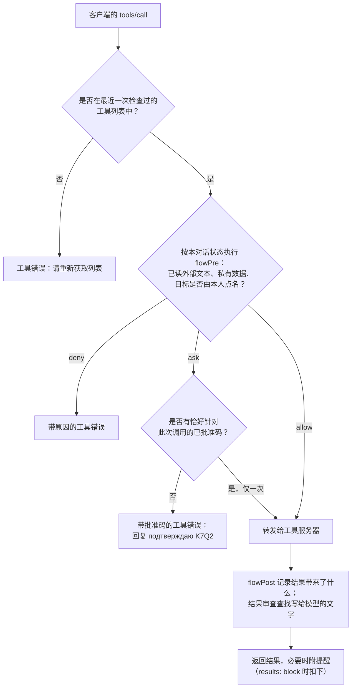
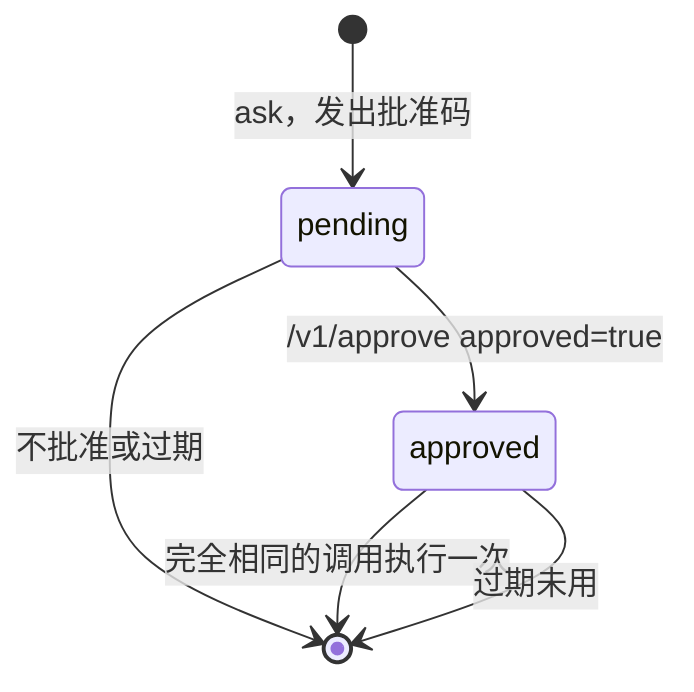

# WARDEN 网关：经 HTTP 访问的工具服务器与决策服务

> 🌐 [English](gateway.md) · [Русский](gateway.ru.md) · [Español](gateway.es.md) · [Français](gateway.fr.md) · **中文**

`warden-mcp wrap` 保护客户端通过 stdio 启动的 MCP 服务器，[流向守卫](flow-guard.zh.md)（flow guard）通过智能体的钩子接入
（Claude Code、[Codex](codex.zh.md)、[OpenCode](opencode.md)）。很多平台两者都没有：OpenWebUI、n8n、LangChain 服务和
自写的智能体通过 HTTP 调用工具服务器，并在自己的进程里运行一部分工具。`warden-mcp gateway` 用一个进程覆盖它们：

| 路径 | 作用 |
|---|---|
| `/mcp/<name>` | Streamable HTTP 上 MCP 服务器前面的代理 |
| `/openapi/<name>/…` | OpenAPI 工具服务器前面的代理（OpenWebUI 工具服务器、`mcpo`） |
| `/v1/prompt`、`/v1/source`、`/v1/pre`、`/v1/post`、`/v1/approve` | 对不经过代理的部分做流向守卫决策 |
| `/v1/health` | 不带令牌：存活与版本；带令牌：还有服务器列表和模式 |

没有新规则。代理使用与 `wrap` 相同的检查（工具定义关卡、用 `vetAndPin` 固定、结果审查），每个决定都来自流向守卫
（`flowPre`、`flowPost`、`flowPrompt`），每个对话一份状态。代理和决策服务在同一进程中，所以对话通过网页搜索读到的页面，
会计入模型随后经 MCP 服务器发起的发送。



**状态（2026-11-17）：已包含在 WARDEN 0.30.0 中。** 单元测试（网关 37 个，Python 适配器 24 个）以及在
OpenWebUI v0.11.4 上的实机检查（`scripts/openwebui-live-check.sh`，结果见 [docs/openwebui.zh.md](openwebui.zh.md#实机检查)）。
为期两周的 `audit` 试点尚未进行。

## 启动

```bash
export WARDEN_GATEWAY_TOKEN="$(openssl rand -hex 24)"
export WARDEN_APPROVE_TOKEN="$(openssl rand -hex 24)"
warden-mcp gateway --config gateway.json
```

```json
{
  "listen": { "host": "127.0.0.1", "port": 8787 },
  "approveTokenEnv": "WARDEN_APPROVE_TOKEN",
  "stateDir": "/var/lib/warden-gateway",
  "servers": [
    { "name": "crm", "type": "mcp-http", "url": "http://crm-mcp:8000/mcp", "headers": { "Authorization": "Bearer ${CRM_KEY}" } },
    { "name": "tools", "type": "openapi", "url": "http://mcpo:8000/" }
  ]
}
```

| 字段 | 默认值 | 含义 |
|---|---|---|
| `listen.host`、`listen.port` | `127.0.0.1`、`8787` | 网关监听的位置。使用本地地址或 Docker 内部网络，不要用公网地址 |
| `tokenEnv` | `WARDEN_GATEWAY_TOKEN` | 存放客户端所发 bearer 令牌的变量。没有 24 个字符以上的令牌，网关拒绝启动 |
| `approveTokenEnv` | — | 可选的第二个令牌，只在 `/v1/approve` 上有效。交给适配器，绝不交给工具连接 |
| `chatHeader`、`userHeader` | `X-OpenWebUI-Chat-Id`、`X-OpenWebUI-User-Id` | 在代理调用中标明对话和用户的请求头 |
| `servers[].headers` | — | 每次请求都发给该服务器。`${NAME}` 从环境变量读取；客户端自己的 `Authorization` 绝不转发 |
| `stateDir` | `~/.local/state/warden-gateway` | 固定记录、观测、每个对话的流向守卫状态和批准码，与 Claude Code 插件的分开 |
| `flowPolicy` | `<stateDir>/flow-policy.json` | [流向守卫策略](flow-guard.zh.md)：`mode`、`labels`、`trustedSources`、`allowedDestinations` 等 |
| `policy` | WARDEN 默认值 | 工具定义关卡，同 `wrap --policy` |
| `results` | `warn` | 结果审查：`warn` 在写给模型的文字前加提醒，`block` 扣下结果，`off` 关闭 |
| `approvePhrase` | `подтверждаю` | 批准码前的词（`approve` 也始终接受） |
| `approvalTtlSeconds` | `600` | 批准码的有效时间 |
| `retentionDays` | `30` | 对话状态的保存期限。状态存在期间，外部文本不会“失效”；状态被删除的对话回来时视为已读取外部文本 |
| `maxBodyBytes`、`upstreamTimeoutMs` | 4 MiB、120 秒 | 每个请求和每次调用工具服务器的上限 |
| `requireAdapter` | `true` | 平台适配器从未上报过消息的对话，视为已读取外部文本。对不经适配器、只用代理的客户端（n8n、LangChain）设为 `false`；其批准随后由运营者自己的代码发往 `/v1/approve` |

未知字段会阻止启动，与 `wrap --policy` 相同。运行时只用 Node 内置模块。

## 代理

**Streamable HTTP 上的 MCP。** 网关自己回答 `tools/list`：从服务器读取每一页，运行关卡和固定，只返回裁决允许的工具。定义
变化后列表被阻止，直到有人审阅（`WARDEN_STATE_DIR=<stateDir> warden-mcp pins status|approve --id gateway:<name>`），任何会话
之前看到的工具都不再可调用。被阻止的列表以空列表而不是错误返回：OpenWebUI 0.11 遇到 `tools/list` 错误会让整条消息失败，
而对话中的其他服务器应当继续工作。

`tools/call` 先交给决策服务；允许的调用被转发，结果被记录并审查。`resources/read`、`prompts/get` 和
`completion/complete` 在发送前以同样方式评判（资源 URI 可能把数据带出去），结果被记录并审查；提醒放进资源内容或提示词
消息里。回复以 JSON 或 SSE 流返回，与服务器发送的方式一致；进度通知立即通过，回复等待检查完成。`initialize`、其他通知、
列表、GET 流和 `DELETE` 原样通过，与 `wrap` 相同。

什么算回复，按宽松客户端的读法来定：凡带 `result` 或 `error` 的消息都是回复，不论其 `method` 写什么（包括
`"method": null`）；id 按 MCP 客户端的方式比较（`5` 和 `"5"` 是同一个 id）。在服务器的任何回复中，只有对客户端本次请求的
回复、以及请求和通知能到达客户端；其他回复、批量消息（batch）和无法解析的数据一律丢弃，`last-event-id` 不转发，因此恢复
或错投的工具结果无法未经审查就到达。没有 id 的 `tools/call` 被拒绝。每个请求只接受一条 JSON-RPC 消息。

**OpenAPI。** 服务器 `openapi.json` 中的每个操作都是一个以其 `operationId` 命名的工具，像 MCP 工具一样检查和固定。每次调用
都会读取规范，字节变化时重新检查，所以在两次调用之间修改描述的服务器，会在第二次调用运行前被检查。客户端拿到的规范只列出
允许的操作，且任何层级都没有 `servers`，因此调用会回到网关。调用匹配到最具体的操作（字面路径段优先于模板；同等匹配被拒绝）。
路径、query 和 JSON 正文构成参数，同一名字出现在其中两处则拒绝。服务器收到的正文就是 WARDEN 评判过的那份，采用 RFC 8785
形式：重复的键不可能对 WARDEN 表示一个意思、对服务器表示另一个意思；超过 15 位的整数（JSON 数字无法精确承载）被拒绝，应
改用字符串发送。批准码绑定到这个确切的请求（方法、路径、query、正文）。

对流向守卫策略而言，每个工具都是 `mcp__<server>__<tool>`，所以标签写法与 Claude Code 相同。

## 被拒绝的调用

| 决定 | MCP 代理 | OpenAPI 代理 | `/v1/pre` |
|---|---|---|---|
| `allow` | 转发 | 转发 | `{"decision":"allow"}` |
| `deny` | 带原因的工具错误 | HTTP 403 `{"detail": …}` | `{"decision":"deny","reason","message","refusal"}` |
| `ask` | 带原因和批准码的工具错误 | 带批准码的 HTTP 403 | 同上，另加 `code` 和 `preview` |

模型读到拒绝后应告诉本人。对 `ask`，文本写着：请原样回复 `подтверждаю K7Q2`。批准码随机生成，有效十分钟，绑定到对话、用户、
工具以及确切参数的哈希（RFC 8785），只能用于一次调用。批准码是 `<stateDir>/gateway/approvals` 下的文件（独占创建，以重命名
方式应答和消耗），所以重启不会丢失，多个网关进程也可共用一个状态目录；过期的批准码及其保存的参数预览，会在下一次调用或每
六小时的清理时删除。只有 `/v1/approve` 能把批准码变成授权，且只有平台适配器调用这条路由——来自本人自己的消息或平台的确认
对话框。网页、文档或模型自己回答里的批准码不起任何作用。参数不同、对话不同或第二次使用，都会重新询问。



对话未知（没有对话请求头）的调用，按读过外部文本之后的调用评判，并且不带批准码直接拒绝。本人看到的预览会标出所有被缩短的
地方。带 `.` 或 `..` 路径段、或带反斜杠（原样或 `%5c`）的路径被拒绝。

## 决策服务

所有路由都接收含 `chat_id` 和 `user_id` 的 JSON，并要求 `Authorization: Bearer <token>`。

| 路由 | 正文 | 调用 |
|---|---|---|
| `POST /v1/prompt` | `prompt` | `flowPrompt`：本人自己的话和其点名的目标。若网关原先没有该对话的状态，返回 `first: true` |
| `POST /v1/source` | `kind`（`web_search`、`url`、`document`、`file`、`knowledge`、`other`）、`url`、`query`、`name`、`text` | 对读取器执行 `flowPost`：对话现在含有外部文本 |
| `POST /v1/pre` | `server`、`tool_name`、`tool_input` | `flowPre`，然后是批准码逻辑。`server: "builtin"` 表示平台自带工具：`search_web` / `fetch_url` 变为 `WebSearch` / `WebFetch`，其余为 `mcp__owui__<tool>` |
| `POST /v1/post` | `server`、`tool_name`、`tool_input`、`tool_response`、`tool_error` | `flowPost` 与结果审查：`notice`、`flowNote`、`withhold` |
| `POST /v1/approve` | `code`、`approved`、`peek` | 记录本人的回答（`peek: true` 只返回工具和预览）；配置了批准令牌时需要该令牌 |

模式即流向守卫策略的模式：`audit` 让所有调用运行并记录 `deny` 会拒绝什么，`ask` 带批准码拒绝，`deny` 不带批准码拒绝，
`off` 关闭。请从 `audit` 开始。在 `audit` 下，`/v1/pre` 的回答还带有 `wouldRefuse`，即 `deny` 会给出的原因（自 0.31.0 起），日志行中
也有。

## 日志与标签

决定写入 `<stateDir>/claude-code/flow/*.log` 下按对话划分的日志，与 Claude Code 插件写的 JSON 行相同，另加一条 `gateway`
事件，含 `chat_id`、`user_id`、工具、决定、原因和结果。参数和结果不写入日志。`node scripts/flow-log-stats.mjs <stateDir>`
可统计；在 `audit` 下显示 `deny` 本会拒绝的内容。

`warden-mcp gateway labels --config gateway.json` 列出对话用过但没有运营者标签的工具，附上守卫的推测和一段可修改后粘贴进
策略的 `labels`。没有标签的工具按未知 MCP 工具处理：其结果是外部文本，当其名字或参数表明在发送时，就算作发送。

## 部署

- 把网关和工具服务器放在私有网络中。工具服务器必须**只能**经由网关访问，否则客户端可以绕过网关。
- 把工具服务器的密钥交给网关（`servers[].headers` 配合 `${ENV}`），而不是交给平台。
- 每个平台实例一个网关进程，或多个实例共用一个。所有状态都是 `stateDir` 下的文件（对话状态有文件锁，批准码独占创建、以
  重命名消耗），所以多个进程可以共用。

## 它不做什么

- 只看得到经过它的内容。平台自己运行的工具（OpenWebUI 的代码解释器、内置工具、未加守卫的函数）除非被包装或关闭，否则不可见。
- 不区分找到的文本中有用的部分和被注入的部分：网页搜索之后，整个对话都视为已读取外部文本。
- 不检查模型的回答（`flowStop`）；那是后续阶段。
- 平台管理员可以关闭适配器。
