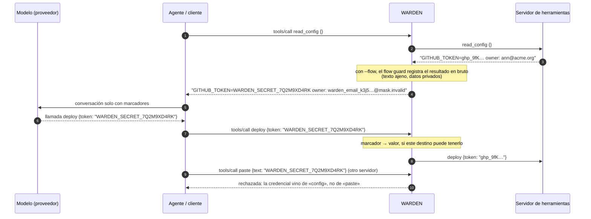
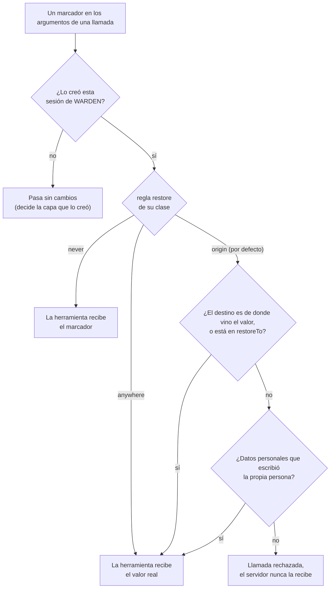
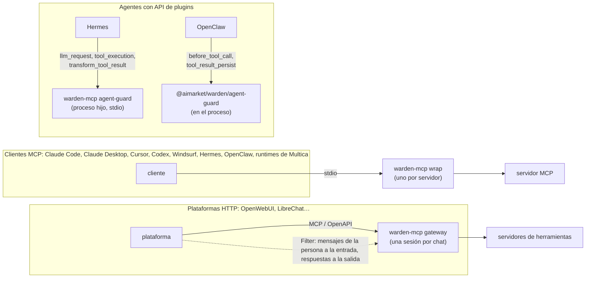

# Enmascaramiento: las claves y los datos personales no llegan al modelo

> 🌐 [English](masking.md) · [Русский](masking.ru.md) · **Español** · [Français](masking.fr.md) · [中文](masking.zh.md)

Un agente lee un archivo de configuración, una fila de una base de datos o un ticket, y todo lo que leyó va al
proveedor del modelo: un token de despliegue, el correo de un cliente, un IBAN. WARDEN sustituye esos valores por
marcadores antes de que el modelo los lea y devuelve los valores reales cuando el modelo usa un marcador en una llamada
a una herramienta, solo si esa herramienta puede recibirlo. El modelo puede actuar con un valor sin verlo nunca.

- **Credenciales: activado por defecto.** Claves de API de formatos conocidos, claves privadas, JWT, valores de
  `Authorization`, contraseñas en URL, parámetros de consulta con credenciales, valores de campos llamados como
  `password` o `api_key`, y las credenciales del propio entorno de WARDEN.
- **Datos personales: desactivado por defecto, un interruptor para las organizaciones que lo necesitan** (RGPD, CCPA,
  152-FZ, PCI DSS): direcciones de correo, teléfonos, tarjetas de pago, IBAN, direcciones IP públicas, números
  nacionales, y los nombres y patrones que la organización indique.

El enmascaramiento llega con WARDEN 0.37.0 (npm `@aimarket/warden@0.39.1`).

## Cómo funciona



La tabla que une un marcador con su valor vive solo en la memoria del proceso de WARDEN: nunca en disco ni en un
registro, y desaparece con el proceso. En los términos de las [Directrices 01/2025 del CEPD sobre
seudonimización](https://www.edpb.europa.eu/our-work-tools/documents/public-consultations/2025/guidelines-012025-pseudonymisation_en),
el modelo, su proveedor y sus registros forman el *dominio de seudonimización*, y esa tabla es la *información
adicional* que no debe entrar en él. Los marcadores siguen lo que las directrices aconsejan para los seudónimos:

- **Aleatorios.** 50 bits del CSPRNG del sistema, no un hash del valor. Nadie puede calcular un marcador a partir de
  una suposición.
- **Sin partes del valor.** Ni primeros ni últimos caracteres, a diferencia de máscaras como `sk-3f…a83`.
- **Estables dentro de una sesión, distintos entre sesiones.** El modelo sabe que dos resultados hablan de la misma
  persona; dos sesiones no pueden enlazarse por sus marcadores.

El formato es `WARDEN_<TIPO>_<ID>`, por ejemplo `WARDEN_SECRET_7Q2M9XD4RK`; el id son 10 caracteres de Crockford
base32. Una dirección de correo se convierte en `warden_email_<id>@mask.invalid`, así que un campo que debe contener una
dirección (JSON Schema `format: email`) sigue siendo válido; `.invalid` está reservado por el RFC 2606 y el correo
nunca sale de la máquina. Los marcadores solo usan letras, dígitos, `_`, `@` y `.`: atraviesan URL, JSON, Markdown y
órdenes de shell sin cambios.

### Adónde puede ir un marcador



- **origin** (por defecto): de vuelta al servidor del que vino. Una clave leída del servidor `vault` vuelve a `vault`,
  no a `pastebin`, aunque una inyección de prompt convenza al modelo de intentarlo. `restoreTo` añade destinos:
  `server` o `server/tool`, con `*`.
- **anywhere**: cualquier herramienta. Solo para datos personales dentro de un único sistema de confianza.
- **never**: redacción pura. La herramienta recibe el texto del marcador.
- **Lo que la persona escribió** en el chat es suyo: sus datos personales van a cualquier herramienta. Una clave que
  escribió solo va adonde indique `restoreTo`, la misma regla que aplica el flow guard a un secreto escrito.
- **Los marcadores desconocidos pasan sin cambios**, así que dos capas de WARDEN se combinan: el marcador creado por un
  gateway delante de un servidor envuelto lo resuelve la capa que lo creó.

El flow guard sigue juzgando cada llamada, y la juzga tal como se ejecutará, con los valores reales puestos. Con su
política por defecto, una llamada que lleva un secreto de formato reconocido se rechaza incluso hacia su origen: en la
prueba de Hermes de abajo, `printf %s <token> | sha256sum` se rechazó hasta que se desactivó el flow guard. El
enmascaramiento decide adónde puede ir un valor; el flow guard decide si una llamada debe ejecutarse.

## Dónde funciona



| Integración | Qué se enmascara | Qué se restaura | Notas |
|---|---|---|---|
| `wrap` (cualquier cliente MCP stdio) | Todo lo que devuelve el servidor envuelto: resultados, errores, recursos, prompts, autocompletados, notificaciones de registro y progreso, peticiones de sampling | Argumentos de llamadas, URI de recursos, argumentos de prompts, valores de autocompletado, resultados de sampling | Credenciales por defecto. Las herramientas integradas del cliente (su propia lectura de archivos, su shell) no pasan por `wrap` |
| `gateway`, MCP sobre HTTP | Lo mismo, por chat (`X-OpenWebUI-Chat-Id`) | Argumentos de llamadas, parámetros de lectura | También se enmascaran los valores de cabecera que el gateway envía a sus servidores |
| `gateway`, OpenAPI | El resultado JSON, conservando su forma | Ruta, query (codificada para URL) y cuerpo (reescrito en forma RFC 8785) | |
| Filter de OpenWebUI (`warden_filter.py`) | Los mensajes de la persona y el historial antes del modelo (solo texto, las imágenes no se tocan); resultados de las herramientas propias de OpenWebUI | Argumentos de las herramientas propias de OpenWebUI | `reveal_answers` muestra a la persona sus datos personales; `mask_fail_closed` no envía el mensaje al modelo si el gateway no responde |
| Plugin de Hermes | **Todo lo que recibe el proveedor** (`llm_request`): mensajes, resultados, prompt de sistema, memoria; los resultados otra vez antes de entrar en el almacén de sesiones | Argumentos al ejecutar (`tool_execution`), después de que las aprobaciones y las comprobaciones vieran el marcador | Probado en vivo, ver abajo |
| Plugin de OpenClaw | Resultados y mensajes al escribirse en la transcripción | Parámetros de herramientas (`before_tool_call`) | **Dentro de una ejecución el modelo ve el resultado en bruto**: OpenClaw 2026.11.6 no tiene un hook que reescriba un resultado antes de que lo lea el modelo. Envuelva los servidores MCP para protegerse dentro de la ejecución; el flow guard sigue impidiendo que un secreto salga |
| Codex, Claude Code, Cursor, Multica | Mediante `wrap` para cada servidor MCP | Mediante `wrap` | Sus API de hooks no pueden reescribir la salida de una herramienta integrada; el flow guard (plugin de Claude Code, hooks de Codex, plugin de OpenCode) impide que un secreto salga |
| Biblioteca | `new Masker(loadMaskConfig()).session(id).mask(value, {server, tool})` | `.restore(value, {server, tool})` | `@aimarket/warden/mask` |

## Activarlo o cambiarlo

Las credenciales se enmascaran sin configurar nada. Los datos personales necesitan un interruptor:

```bash
# un servidor envuelto
warden-mcp wrap --id crm --mask-personal gdpr -- npx -y my-crm-mcp
# cada proceso de WARDEN que inicia un cliente, sin tocar su configuración
export WARDEN_MASK_PERSONAL=gdpr
# desactivar
warden-mcp wrap --id notes --mask-credentials off -- node notes.js
```

Un archivo JSON (`--mask mask.json`, `WARDEN_MASK=/path/mask.json` o el campo `mask` de la configuración del gateway)
contiene toda la política. Los campos desconocidos son un error:

```json
{
  "credentials": {
    "enabled": true,
    "restore": "origin",
    "restoreTo": ["deploy/*"],
    "exceptTools": ["vault/create_key"],
    "autoEnv": true,
    "envNames": ["STRIPE_KEY"]
  },
  "personal": {
    "enabled": true,
    "profile": "gdpr",
    "restore": "origin",
    "restoreTo": ["mail/send_*"],
    "terms": { "NAME": ["Ann Smith"], "CUSTOMER": ["ACME-77"] },
    "termsFile": "customers.txt",
    "patterns": [{ "kind": "CONTRACT", "pattern": "CTR-[0-9]{6}" }],
    "keep": ["@acme.org", "support@acme.org"],
    "privateIps": false
  },
  "display": { "credentials": false, "personal": true },
  "maxEntries": 10000,
  "idleMinutes": 1440
}
```

| Campo | Significado |
|---|---|
| `restore` | `origin` (por defecto), `anywhere` o `never`, por clase |
| `restoreTo` | Más destinos: `server` o `server/tool`, con `*` |
| `exceptTools` | Herramientas cuyos resultados no se enmascaran, como una que crea una clave que la persona debe copiar |
| `autoEnv` | Enmascarar los valores de las variables de entorno de WARDEN con nombre de credencial (`*_TOKEN`, `*_KEY`, `*PASSWORD`…). El cliente pasa las claves de un servidor en ese entorno, así que se detecta un servidor que imprime su propia clave |
| `terms`, `termsFile` | Nombres, identificadores de clientes y otras palabras de la organización: palabras completas, sin distinguir mayúsculas. Un archivo lleva un término por línea; `TIPO: término` fija el tipo |
| `patterns` | Expresiones regulares con su tipo. Se rechazan las referencias hacia atrás, los lookaround y los cuantificadores anidados: pueden tardar mucho con texto hostil |
| `keep` | Valores que nunca se enmascaran: un valor exacto, o `@dominio` para todas sus direcciones |
| `display` | Lo que `reveal` muestra a la persona: datos personales sí, credenciales no (una transcripción se copia, se comparte y vuelve al modelo) |
| `maxEntries`, `idleMinutes` | Límites por sesión; el marcador usado hace más tiempo caduca y pasa como texto normal |

Orden de precedencia: valores por defecto, luego el archivo (`--mask` o `WARDEN_MASK`), luego `WARDEN_MASK_CREDENTIALS`
y `WARDEN_MASK_PERSONAL` (solo sin `--mask`: el archivo que nombra el operador es toda la política), y luego las
opciones de línea de órdenes.

### Perfiles

Un perfil elige detectores. No hace lícito el tratamiento por sí mismo, y los datos seudonimizados siguen siendo datos
personales según el RGPD.

| Perfil | Para | Tipos |
|---|---|---|
| `gdpr` | RGPD de la UE/EEE, UK GDPR, LPD suiza | EMAIL, PHONE (formato internacional), CARD, IBAN, IP |
| `us` | CCPA/CPRA y leyes estatales similares de EE. UU. | EMAIL, PHONE (internacional y NANP), CARD, SSN, IP |
| `ru-152fz` | Ley federal rusa 152-FZ | EMAIL, PHONE (internacional y `8 9xx`), CARD, SNILS, INN, IP |
| `pci` | Reducción del alcance de PCI DSS | CARD |
| `custom` | Solo los términos y patrones de la organización | ninguno integrado |

### Qué se reconoce y cómo se comprueba

| Tipo | Comprobación |
|---|---|
| SECRET | Unos 40 formatos de proveedores (GitHub, GitLab, AWS, OpenAI y Anthropic, Stripe, Slack, Google, Hugging Face, SendGrid, Twilio, DigitalOcean, Shopify, PyPI, npm, Docker Hub, Vault, Doppler, Grafana, Sentry, Atlassian, Telegram, Discord…); bloques PEM de claves privadas; JWT; valores `Authorization`/`Bearer`; `scheme://user:password@`; parámetros `token=`, `api_key=`, `sig=`, `X-Amz-Signature=` y similares; valores de campos y asignaciones con nombre de credencial; valores de credenciales del entorno de WARDEN. Un valor que otra herramienta ya redactó (`ghp_ab...9f3e`, `***`, `[REDACTED]`) no se toca |
| EMAIL | Forma del RFC 5321; se omiten `example.com/.org/.net`, `.example`, `.invalid`, `.test`, `.localhost` (RFC 2606, RFC 6761) |
| PHONE | `+` o `00` y 8–15 dígitos (UIT-T E.164); formatos nacionales solo en los perfiles `us` y `ru-152fz` |
| CARD | 12–19 dígitos, un rango de emisor de una red en uso (ISO/IEC 7812) y la comprobación de Luhn |
| IBAN | Tabla de longitudes por país y comprobación mod-97 (ISO 13616) |
| IP | IPv4 e IPv6 públicas; se omiten loopback, privadas, link-local, CGNAT y de documentación salvo con `privateIps` (las direcciones IP son datos personales según la sentencia *Breyer* del TJUE, C-582/14) |
| SSN, SNILS, INN | Formato más las reglas o la suma de control del propio número |

Los nombres y las direcciones postales necesitan un modelo de lenguaje para encontrarse. WARDEN no los adivina:
enmascara los nombres que indica la organización. Cada detector está acotado: una prueba los ejecuta todos sobre un
megabyte de texto hostil en menos de tres segundos.

## Hermes y OpenClaw

Los dos agentes ejecutan sus herramientas de archivos, shell y web dentro de su propio proceso, así que `wrap` solo ve
sus servidores MCP. El paquete de npm trae un plugin para cada uno en `integrations/`. Ambos se instalaron y se
probaron con agentes reales: Hermes 0.19.0 en un servidor de producción y OpenClaw 2026.11.6 en un contenedor
desechable (lo que mostró cada prueba está en [Comprobado](#comprobado)).

### Hermes

```bash
npm install -g @aimarket/warden@0.39.1
cp -r "$(npm root -g)/@aimarket/warden/integrations/hermes/warden" ~/.hermes/plugins/warden
hermes plugins enable warden
systemctl restart hermes-gateway     # o vuelva a iniciar hermes
```

El plugin inicia un proceso hijo `warden-mcp agent-guard` y guarda allí la tabla de marcadores; `WARDEN_AGENT_GUARD_CMD`
indica otro comando. La configuración va en `~/.hermes/.env`: `WARDEN_MASK_PERSONAL=gdpr`,
`WARDEN_MASK=/path/mask.json`, `WARDEN_HERMES_FLOW=off` (el enmascaramiento sigue activo), `WARDEN_STATE_DIR`.

| Punto de Hermes | Qué hace WARDEN ahí |
|---|---|
| `llm_request` | Enmascara todo lo que recibe el proveedor: los mensajes de la persona, los resultados de herramientas, el prompt de sistema, la memoria |
| `tool_execution` | Devuelve los valores cuando la herramienta se ejecuta, después de que la ventana de aprobación de Hermes y sus patrones de comandos peligrosos vieran solo el marcador |
| `transform_tool_result` | Enmascara el resultado antes de que entre en el almacén de sesiones |
| `pre_tool_call`, `post_tool_call` | El flow guard; su `ask` se convierte en la propia ventana de aprobación de Hermes |
| `transform_llm_output` | Muestra a la persona sus datos personales (las credenciales siguen enmascaradas) |

Lo propio de Hermes:

- **Su redacción propia es de un solo sentido.** `security.redact_secrets` (activa por defecto) recorta los formatos de
  token conocidos dentro de `read_file` a `ghp_ng...39e5`, y un marcador solo puede devolver la cadena recortada.
  Manténgala si el agente nunca necesita usar un secreto; póngala en `false` para que WARDEN enmascare de forma
  reversible.
- **Orígenes.** Las herramientas de archivos y shell son un mismo lugar, `local`; las de web y navegador, `web`; cada
  servidor MCP, `mcp:<server>`. Una clave leída de un archivo local puede ir a un comando de shell; el mismo marcador en
  una URL de `web_extract` detiene la llamada.
- **Cierre seguro.** Si el hijo `agent-guard` se detiene y no puede reiniciarse, el plugin retiene los resultados de
  las herramientas y rechaza las llamadas que llevan un marcador.
- `WARDEN_HERMES_DEBUG=1` registra el método, la sesión y el nombre de la herramienta de cada petición, nunca un valor.

### OpenClaw

```bash
npm install -g @aimarket/warden@0.39.1
cp -r "$(npm root -g)/@aimarket/warden/integrations/openclaw/warden" ~/openclaw-warden
cd ~/openclaw-warden && npm install --omit=dev
sudo chown -R root:root .
openclaw plugins install --link "$PWD" --force --accept-capabilities
openclaw plugins enable warden
```

Después reinicie el Gateway de OpenClaw. El plugin se ejecuta dentro del proceso del Gateway con la biblioteca de
WARDEN (`@aimarket/warden/agent-guard`), sin proceso hijo. Configuración: `plugins.entries.warden.config` en
`openclaw.json` (`personal`, `maskConfig`, `flowGuard`) o el entorno `WARDEN_MASK*`; `WARDEN_OPENCLAW_FLOW=off` apaga
el flow guard y `WARDEN_OPENCLAW_DEBUG=1` traza los hooks.

| Hook de OpenClaw | Qué hace WARDEN ahí |
|---|---|
| `before_tool_call` | Devuelve los valores a los parámetros; el flow guard bloquea la llamada o pregunta con la aprobación propia de OpenClaw |
| `after_tool_call` | El flow guard registra lo que el resultado trajo a la sesión |
| `tool_result_persist`, `before_message_write` | Enmascara resultados y mensajes al guardarlos y al reenviarlos |
| `message_sending` | Muestra a la persona sus datos personales |

Lo propio de OpenClaw:

- **Dentro del turno que lo produjo, el modelo lee el resultado en bruto.** OpenClaw 2026.11.6 no tiene un hook que
  reescriba el resultado de una herramienta antes de que lo lea el modelo; `tool_result_persist` cambia solo lo que se
  guarda. Los turnos siguientes y la transcripción reciben marcadores. Para protegerse dentro de un turno, ponga los
  servidores MCP detrás de `wrap`; el flow guard sigue rechazando una llamada que lleve un secreto.
- **Los archivos del plugin deben pertenecer a root.** Si no, OpenClaw rechaza el plugin («suspicious ownership»). La
  instalación requiere `--accept-capabilities`.
- **Los hooks se ejecutan en el Gateway.** `openclaw agent exec` ejecuta un turno integrado sin el Gateway y en nuestra
  prueba no llamó a los hooks del plugin; ejecute los agentes a través del Gateway.

## Qué se le dice al modelo

El primer resultado enmascarado de una sesión lleva una nota, después del contenido:

> [WARDEN] 1 SECRET in this result was replaced by placeholders such as WARDEN_SECRET_7Q2M9XD4RK or
> warden_email_…@mask.invalid. You can still use a masked value: write its placeholder, exactly as shown, where the
> value belongs in a tool call (a command, a header, a field). The tool receives the real value if it may have it (by
> default: the place the value came from); otherwise WARDEN refuses the call and says why. You never need to see the
> value, so do not guess, reconstruct or ask for it.

Los resultados siguientes llevan una línea corta. En la prueba de Hermes, una redacción anterior («no intentes adivinar
ni pedir los valores ocultos») hizo que DeepSeek concluyera que no podía usar el token en absoluto; la actual dice qué
hacer.

## Comprobado

- **Pruebas unitarias y de protocolo** (`npm test`): detectores con sus sumas de control y casos de falsos positivos,
  tiempo con entrada hostil, reglas de restauración, el proxy `wrap` con un servidor hijo real (credenciales por
  defecto, `--mask-personal`, el interruptor de entorno, `restore: never`, errores, `--audit-only`), el gateway sobre MCP
  y OpenAPI con sesiones por chat y las rutas `/v1`, `agent-guard` como servicio stdio. Las pruebas del adaptador de
  OpenWebUI (`python3 -m unittest`), el plugin de Hermes contra el `agent-guard` real y el plugin de OpenClaw con una API
  simulada.
- **Hermes 0.19.0 en un servidor real, 22-11-2026**, modelo `deepseek/deepseek-chat` a través de OpenRouter. Un archivo
  contenía un token `ghp_` aleatorio. El almacén de sesiones guarda `GITHUB_TOKEN=WARDEN_SECRET_CG4G9F0HM4`, nunca el
  token. El modelo ejecutó `printf %s WARDEN_SECRET_CG4G9F0HM4 | sha256sum` y el shell imprimió el SHA-256 del token
  real (`c7b5d520…3251`, igual al hash calculado junto al archivo). Con el flow guard activo, la misma llamada se
  rechazó: «this call carries a secret (GitHub token)».
- **La redacción propia de Hermes.** Con `security.redact_secrets: true` (el valor por defecto de Hermes), `read_file`
  ya devuelve `ghp_ng...39e5`: en un solo sentido, así que un marcador solo puede devolver la cadena recortada. Mantenga
  la redacción de Hermes si el agente nunca necesita usar un secreto; desactívela para que WARDEN enmascare de forma
  reversible.
- **OpenClaw 2026.11.6** en un contenedor desechable: con el plugin cargado a través del Gateway, la transcripción y la
  base de datos de sesiones solo contienen el marcador, y el flow guard rechazó `exec` con el token. Dentro de la
  ejecución el modelo sí leyó el archivo en bruto (ver la tabla de arriba).

## Límites

- Solo se enmascara lo que pasa por WARDEN: no las herramientas integradas de un cliente (`Read` de Claude Code, el
  shell de Codex), ni el texto que la persona pega en un cliente sin WARDEN delante.
- En OpenClaw el modelo ve un resultado en bruto dentro de la ejecución que lo produjo.
- La detección se basa en patrones. Una clave de un formato que WARDEN no conoce, en un campo cuyo nombre no lo dice,
  pasa. Los datos personales fuera de los tipos citados (nombres, direcciones, datos de salud en texto libre) necesitan
  `terms` y `patterns`.
- El modelo aún puede razonar sobre el *tipo* de un valor y su contexto («el token del servidor de despliegue»). El
  enmascaramiento oculta valores, no los hechos que los rodean.
- La restauración pone el valor exacto en el lugar exacto donde el modelo escribió el marcador. Un valor escrito en un
  archivo a través del servidor del que vino acaba en disco. Normalmente esa es la intención, y el flow guard lo juzga
  como cualquier escritura.
- Un reinicio de WARDEN olvida todos los marcadores; los antiguos pasan después como texto normal y ninguna llamada
  puede convertirlos en valores.
- Los registros anotan tipos y cantidades (`masked SECRET×1 in read_config`), nunca valores; los registros de chat del
  gateway anotan lo mismo.
