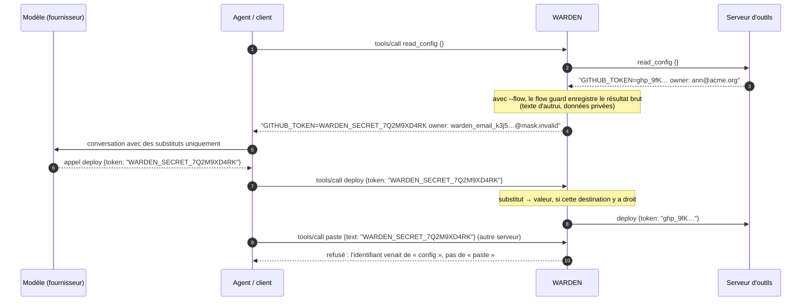
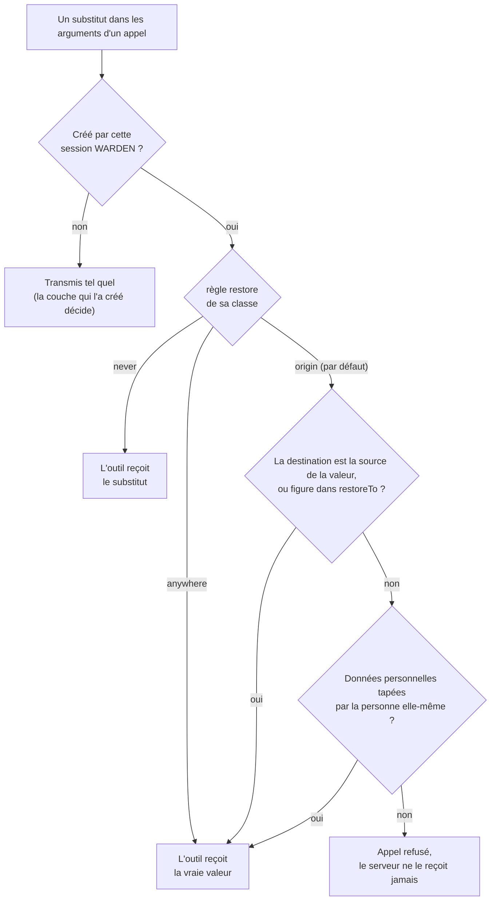
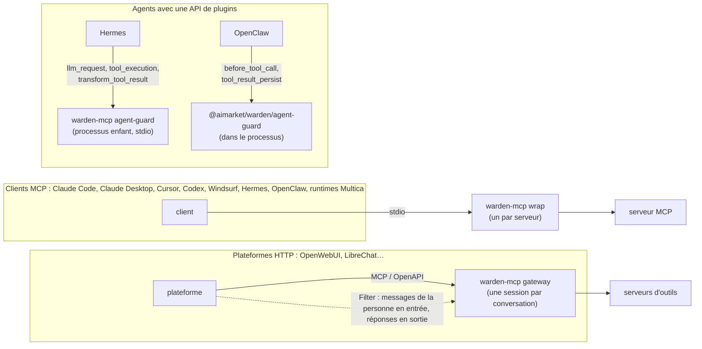

# Masquage : les clés et les données personnelles n'atteignent pas le modèle

> 🌐 [English](masking.md) · [Русский](masking.ru.md) · [Español](masking.es.md) · **Français** · [中文](masking.zh.md)

Un agent lit un fichier de configuration, une ligne de base de données ou un ticket, et tout ce qu'il a lu part chez le
fournisseur du modèle : un jeton de déploiement, l'adresse d'un client, un IBAN. WARDEN remplace ces valeurs par des
substituts avant que le modèle ne les lise, et remet les vraies valeurs quand le modèle utilise un substitut dans un
appel d'outil, uniquement pour un outil autorisé à les recevoir. Le modèle peut agir avec une valeur sans jamais la
voir.

- **Identifiants : activé par défaut.** Clés d'API de formats connus, clés privées, JWT, valeurs d'`Authorization`,
  mots de passe dans les URL, paramètres de requête portant un identifiant, valeurs des champs nommés comme `password`
  ou `api_key`, et les identifiants de l'environnement de WARDEN lui-même.
- **Données personnelles : désactivé par défaut, un interrupteur pour les organisations qui en ont besoin** (RGPD,
  CCPA, 152-FZ, PCI DSS) : adresses e-mail, numéros de téléphone, cartes de paiement, IBAN, adresses IP publiques,
  numéros nationaux, ainsi que les noms et motifs que l'organisation liste.

Le masquage est livré avec WARDEN 0.37.0 (npm `@aimarket/warden@0.40.0`).

## Fonctionnement



La table qui relie un substitut à sa valeur reste dans la mémoire du processus WARDEN : jamais sur disque, jamais dans
un journal, disparue avec le processus. Dans les termes des [lignes directrices 01/2025 du CEPD sur la
pseudonymisation](https://www.edpb.europa.eu/our-work-tools/documents/public-consultations/2025/guidelines-012025-pseudonymisation_en),
le modèle, son fournisseur et leurs journaux forment le *domaine de pseudonymisation*, et cette table est
l'*information supplémentaire* qui ne doit pas y entrer. Les substituts suivent ce que les lignes directrices
conseillent pour les pseudonymes :

- **Aléatoires.** 50 bits du CSPRNG du système, pas un hachage de la valeur. Personne ne peut calculer un substitut à
  partir d'une supposition.
- **Sans fragment de la valeur.** Ni premiers ni derniers caractères, contrairement aux masques du type `sk-3f…a83`.
- **Stables dans une session, différents d'une session à l'autre.** Le modèle sait que deux résultats parlent de la
  même personne ; deux sessions ne peuvent pas être reliées par leurs substituts.

Le format est `WARDEN_<TYPE>_<ID>`, par exemple `WARDEN_SECRET_7Q2M9XD4RK` ; l'id fait 10 caractères en base32 de
Crockford. Une adresse e-mail devient `warden_email_<id>@mask.invalid`, si bien qu'un champ qui doit contenir une
adresse (JSON Schema `format: email`) reste valide ; `.invalid` est réservé par la RFC 2606, un courrier vers ce domaine
ne quitte jamais la machine. Les substituts n'utilisent que des lettres, des chiffres, `_`, `@` et `.` : ils traversent
URL, JSON, Markdown et commandes shell sans modification.

### Où un substitut peut aller



- **origin** (par défaut) : retour au serveur d'où la valeur vient. Une clé lue sur le serveur `vault` retourne vers
  `vault`, pas vers `pastebin`, même si une injection de prompt convainc le modèle d'essayer. `restoreTo` ajoute des
  destinations : `server` ou `server/tool`, avec `*`.
- **anywhere** : n'importe quel outil. À réserver aux données personnelles au sein d'un seul système de confiance.
- **never** : simple caviardage. L'outil reçoit le texte du substitut.
- **Ce que la personne a tapé** dans la conversation lui appartient : ses propres données personnelles vont vers
  n'importe quel outil. Une clé qu'elle a tapée ne va que là où `restoreTo` l'indique, la même règle que le flow guard
  applique à un secret tapé.
- **Les substituts inconnus passent tels quels**, donc deux couches WARDEN se combinent : un substitut créé par une
  passerelle devant un serveur encapsulé est résolu par la couche qui l'a créé.

Le flow guard juge toujours chaque appel, et il le juge tel qu'il s'exécutera, avec les vraies valeurs remises. Avec
sa politique par défaut, un appel qui porte un secret de format reconnu est refusé même vers sa source : dans le test
Hermes ci-dessous, `printf %s <jeton> | sha256sum` a été refusé jusqu'à ce que le flow guard soit désactivé. Le masquage
décide où une valeur peut aller ; le flow guard décide si un appel doit s'exécuter.

## Où cela fonctionne



| Intégration | Ce qui est masqué | Ce qui est restauré | Remarques |
|---|---|---|---|
| `wrap` (tout client MCP stdio) | Tout ce que renvoie le serveur encapsulé : résultats, erreurs, ressources, prompts, complétions, notifications de journal et de progression, requêtes de sampling | Arguments d'appel, URI de ressources, arguments de prompts, valeurs de complétion, résultats de sampling | Identifiants par défaut. Les outils intégrés du client (sa propre lecture de fichiers, son shell) ne passent pas par `wrap` |
| `gateway`, MCP sur HTTP | La même chose, par conversation (`X-OpenWebUI-Chat-Id`) | Arguments d'appel, paramètres de lecture | Les valeurs d'en-tête que la passerelle envoie à ses serveurs sont masquées aussi |
| `gateway`, OpenAPI | Le résultat JSON, en gardant sa forme | Chemin, query (encodée pour URL) et corps (réécrit en forme RFC 8785) | |
| Filter OpenWebUI (`warden_filter.py`) | Les messages de la personne et l'historique avant le modèle (texte seulement, images intactes) ; résultats des outils propres à OpenWebUI | Arguments des outils propres à OpenWebUI | `reveal_answers` montre à la personne ses données personnelles ; `mask_fail_closed` n'envoie pas le message au modèle si la passerelle ne répond pas |
| Plugin Hermes | **Tout ce que reçoit le fournisseur** (`llm_request`) : messages, résultats, prompt système, mémoire ; les résultats encore avant le stockage des sessions | Arguments à l'exécution (`tool_execution`), après que les approbations et les garde-fous ont vu le substitut | Testé en conditions réelles, voir plus bas |
| Plugin OpenClaw | Résultats et messages à l'écriture dans la transcription | Paramètres d'outils (`before_tool_call`) | **Pendant une exécution, le modèle voit le résultat brut** : OpenClaw 2026.11.6 n'a pas de hook qui réécrit un résultat avant que le modèle le lise. Encapsulez les serveurs MCP pour une protection pendant l'exécution ; le flow guard empêche toujours un secret de sortir |
| Codex, Claude Code, Cursor, Multica | Via `wrap` pour chaque serveur MCP | Via `wrap` | Leurs API de hooks ne peuvent pas réécrire la sortie d'un outil intégré ; le flow guard (plugin Claude Code, hooks Codex, plugin OpenCode) empêche un secret de sortir |
| Bibliothèque | `new Masker(loadMaskConfig()).session(id).mask(value, {server, tool})` | `.restore(value, {server, tool})` | `@aimarket/warden/mask` |

## L'activer ou le modifier

Les identifiants sont masqués sans aucun réglage. Les données personnelles demandent un interrupteur :

```bash
# un serveur encapsulé
warden-mcp wrap --id crm --mask-personal gdpr -- npx -y my-crm-mcp
# chaque processus WARDEN lancé par un client, sans toucher à sa configuration
export WARDEN_MASK_PERSONAL=gdpr
# désactiver
warden-mcp wrap --id notes --mask-credentials off -- node notes.js
```

Un fichier JSON (`--mask mask.json`, `WARDEN_MASK=/path/mask.json` ou le champ `mask` de la configuration de la
passerelle) contient toute la politique. Un champ inconnu est une erreur :

```json
{
  "credentials": {
    "enabled": true,
    "restore": "origin",
    "restoreTo": ["deploy/*"],
    "exceptTools": ["vault/create_key"],
    "autoEnv": true,
    "envNames": ["STRIPE_KEY"]
  },
  "personal": {
    "enabled": true,
    "profile": "gdpr",
    "restore": "origin",
    "restoreTo": ["mail/send_*"],
    "terms": { "NAME": ["Ann Smith"], "CUSTOMER": ["ACME-77"] },
    "termsFile": "customers.txt",
    "patterns": [{ "kind": "CONTRACT", "pattern": "CTR-[0-9]{6}" }],
    "keep": ["@acme.org", "support@acme.org"],
    "privateIps": false
  },
  "display": { "credentials": false, "personal": true },
  "maxEntries": 10000,
  "idleMinutes": 1440
}
```

| Champ | Signification |
|---|---|
| `restore` | `origin` (par défaut), `anywhere` ou `never`, par classe |
| `restoreTo` | Destinations supplémentaires : `server` ou `server/tool`, avec `*` |
| `exceptTools` | Outils dont les résultats ne sont pas masqués, par exemple un outil qui crée une clé que la personne doit copier |
| `autoEnv` | Masquer les valeurs des variables d'environnement de WARDEN nommées comme des identifiants (`*_TOKEN`, `*_KEY`, `*PASSWORD`…). Le client transmet les clés d'un serveur dans cet environnement, donc un serveur qui affiche sa propre clé est repéré |
| `terms`, `termsFile` | Noms, identifiants clients et autres mots listés par l'organisation : mots entiers, sans tenir compte de la casse. Un fichier contient un terme par ligne ; `TYPE: terme` fixe le type |
| `patterns` | Expressions régulières avec leur type. Les références arrière, les lookaround et les quantificateurs imbriqués sont refusés : ils peuvent durer longtemps sur un texte hostile |
| `keep` | Valeurs jamais masquées : une valeur exacte, ou `@domaine` pour toutes ses adresses |
| `display` | Ce que `reveal` montre à la personne : données personnelles oui, identifiants non (une transcription est copiée, partagée et renvoyée au modèle) |
| `maxEntries`, `idleMinutes` | Limites par session ; le substitut le moins récemment utilisé expire, puis passe comme du texte ordinaire |

Ordre de priorité : valeurs par défaut, puis le fichier (`--mask` ou `WARDEN_MASK`), puis `WARDEN_MASK_CREDENTIALS` et
`WARDEN_MASK_PERSONAL` (seulement sans `--mask` : le fichier désigné par l'opérateur est toute la politique), puis les
options de la ligne de commande.

### Profils

Un profil choisit des détecteurs. Il ne rend pas le traitement licite à lui seul, et les données pseudonymisées restent
des données personnelles au sens du RGPD.

| Profil | Pour | Types |
|---|---|---|
| `gdpr` | RGPD UE/EEE, UK GDPR, LPD suisse | EMAIL, PHONE (format international), CARD, IBAN, IP |
| `us` | CCPA/CPRA et lois similaires des États américains | EMAIL, PHONE (international et NANP), CARD, SSN, IP |
| `ru-152fz` | Loi fédérale russe 152-FZ | EMAIL, PHONE (international et `8 9xx`), CARD, SNILS, INN, IP |
| `pci` | Réduction du périmètre PCI DSS | CARD |
| `custom` | Seulement les termes et motifs de l'organisation | aucun intégré |

### Ce qui est reconnu, et comment c'est vérifié

| Type | Vérification |
|---|---|
| SECRET | Une quarantaine de formats de fournisseurs (GitHub, GitLab, AWS, OpenAI et Anthropic, Stripe, Slack, Google, Hugging Face, SendGrid, Twilio, DigitalOcean, Shopify, PyPI, npm, Docker Hub, Vault, Doppler, Grafana, Sentry, Atlassian, Telegram, Discord…) ; blocs PEM de clés privées ; JWT ; valeurs `Authorization`/`Bearer` ; `scheme://user:password@` ; paramètres `token=`, `api_key=`, `sig=`, `X-Amz-Signature=` et semblables ; valeurs des champs et affectations nommés comme des identifiants ; valeurs d'identifiants de l'environnement de WARDEN. Une valeur qu'un autre outil a déjà caviardée (`ghp_ab...9f3e`, `***`, `[REDACTED]`) n'est pas touchée |
| EMAIL | Forme de la RFC 5321 ; `example.com/.org/.net`, `.example`, `.invalid`, `.test`, `.localhost` sont ignorés (RFC 2606, RFC 6761) |
| PHONE | `+` ou `00` et 8 à 15 chiffres (UIT-T E.164) ; formats nationaux seulement dans les profils `us` et `ru-152fz` |
| CARD | 12 à 19 chiffres, une plage d'émetteur d'un réseau en service (ISO/IEC 7812) et la clé de Luhn |
| IBAN | Table des longueurs par pays et contrôle mod-97 (ISO 13616) |
| IP | IPv4 et IPv6 publiques ; loopback, privées, link-local, CGNAT et plages de documentation ignorées sauf avec `privateIps` (les adresses IP sont des données personnelles selon l'arrêt *Breyer* de la CJUE, C-582/14) |
| SSN, SNILS, INN | Format plus les règles ou la somme de contrôle propres au numéro |

Les noms et les adresses postales demandent un modèle de langage pour être trouvés. WARDEN ne les devine pas : il
masque les noms que l'organisation liste. Chaque détecteur est borné : un test les exécute tous sur un mégaoctet de
texte hostile en moins de trois secondes.

## Hermes et OpenClaw

Les deux agents exécutent leurs outils de fichiers, de shell et web dans leur propre processus : `wrap` ne voit donc que
leurs serveurs MCP. Le paquet npm contient un plugin pour chacun dans `integrations/`. Tous deux ont été installés et
essayés sur de vrais agents : Hermes 0.19.0 sur un serveur de production et OpenClaw 2026.11.6 dans un conteneur
jetable (ce que chaque essai a montré figure dans [Vérifié](#vérifié)).

### Hermes

```bash
npm install -g @aimarket/warden@0.40.0
cp -r "$(npm root -g)/@aimarket/warden/integrations/hermes/warden" ~/.hermes/plugins/warden
hermes plugins enable warden
systemctl restart hermes-gateway     # ou relancez hermes
```

Le plugin lance un processus enfant `warden-mcp agent-guard`, qui garde la table des substituts ;
`WARDEN_AGENT_GUARD_CMD` désigne une autre commande. Les réglages vont dans `~/.hermes/.env` :
`WARDEN_MASK_PERSONAL=gdpr`, `WARDEN_MASK=/path/mask.json`, `WARDEN_HERMES_FLOW=off` (le masquage reste actif),
`WARDEN_STATE_DIR`.

| Point d'accroche Hermes | Ce que WARDEN y fait |
|---|---|
| `llm_request` | Masque tout ce que reçoit le fournisseur : les messages de la personne, les résultats d'outils, le prompt système, la mémoire |
| `tool_execution` | Remet les valeurs au lancement de l'outil, après que la demande d'approbation de Hermes et ses motifs de commandes dangereuses n'ont vu que le substitut |
| `transform_tool_result` | Masque un résultat avant qu'il n'entre dans le stockage des sessions |
| `pre_tool_call`, `post_tool_call` | Le flow guard ; son `ask` devient la demande d'approbation propre à Hermes |
| `transform_llm_output` | Rend à la personne ses données personnelles (les identifiants restent masqués) |

Ce qui est propre à Hermes :

- **Sa propre rédaction est à sens unique.** `security.redact_secrets` (active par défaut) coupe les formats de jeton
  connus dans `read_file` en `ghp_ng...39e5`, et un substitut ne peut rendre que la chaîne coupée. Gardez-la si l'agent
  n'a jamais besoin d'utiliser un secret ; mettez-la à `false` pour que WARDEN masque de façon réversible.
- **Origines.** Les outils de fichiers et de shell sont un seul lieu, `local` ; les outils web et navigateur, `web` ;
  chaque serveur MCP, `mcp:<server>`. Une clé lue dans un fichier local peut aller dans une commande shell ; le même
  substitut dans une URL de `web_extract` arrête l'appel.
- **Fermeture par défaut.** Si l'enfant `agent-guard` s'arrête et ne peut pas redémarrer, le plugin retient les
  résultats d'outils et refuse les appels qui portent un substitut.
- `WARDEN_HERMES_DEBUG=1` journalise la méthode, la session et le nom de l'outil de chaque requête, jamais une valeur.

### OpenClaw

```bash
npm install -g @aimarket/warden@0.40.0
cp -r "$(npm root -g)/@aimarket/warden/integrations/openclaw/warden" ~/openclaw-warden
cd ~/openclaw-warden && npm install --omit=dev
sudo chown -R root:root .
openclaw plugins install --link "$PWD" --force --accept-capabilities
openclaw plugins enable warden
```

Redémarrez ensuite le Gateway d'OpenClaw. Le plugin tourne dans le processus du Gateway avec la bibliothèque de WARDEN
(`@aimarket/warden/agent-guard`), sans processus enfant. Réglages : `plugins.entries.warden.config` dans
`openclaw.json` (`personal`, `maskConfig`, `flowGuard`) ou l'environnement `WARDEN_MASK*` ; `WARDEN_OPENCLAW_FLOW=off`
coupe le flow guard et `WARDEN_OPENCLAW_DEBUG=1` trace les hooks.

| Hook OpenClaw | Ce que WARDEN y fait |
|---|---|
| `before_tool_call` | Remet les valeurs dans les paramètres ; le flow guard bloque l'appel ou demande via l'approbation propre à OpenClaw |
| `after_tool_call` | Le flow guard note ce que le résultat a apporté dans la session |
| `tool_result_persist`, `before_message_write` | Masque résultats et messages quand ils sont enregistrés et rejoués |
| `message_sending` | Rend à la personne ses données personnelles |

Ce qui est propre à OpenClaw :

- **Dans le tour qui l'a produit, le modèle lit le résultat brut.** OpenClaw 2026.11.6 n'a pas de hook qui réécrit le
  résultat d'un outil avant que le modèle ne le lise ; `tool_result_persist` ne change que ce qui est enregistré. Les
  tours suivants et la transcription reçoivent des substituts. Pour une protection dans le tour, placez les serveurs MCP
  derrière `wrap` ; le flow guard refuse toujours un appel qui porte un secret.
- **Les fichiers du plugin doivent appartenir à root.** Sinon OpenClaw refuse le plugin (« suspicious ownership »).
  L'installation exige `--accept-capabilities`.
- **Les hooks tournent dans le Gateway.** `openclaw agent exec` exécute un tour intégré sans le Gateway et, lors de
  notre essai, n'a pas appelé les hooks du plugin ; faites passer les agents par le Gateway.

## Ce qui est dit au modèle

Le premier résultat masqué d'une session porte une note, après le contenu :

> [WARDEN] 1 SECRET in this result was replaced by placeholders such as WARDEN_SECRET_7Q2M9XD4RK or
> warden_email_…@mask.invalid. You can still use a masked value: write its placeholder, exactly as shown, where the
> value belongs in a tool call (a command, a header, a field). The tool receives the real value if it may have it (by
> default: the place the value came from); otherwise WARDEN refuses the call and says why. You never need to see the
> value, so do not guess, reconstruct or ask for it.

Les résultats suivants portent une ligne courte. Dans le test Hermes, une formulation antérieure (« n'essaie pas de
deviner ni de demander les valeurs cachées ») a conduit DeepSeek à conclure qu'il ne pouvait pas du tout utiliser le
jeton ; la formulation actuelle dit quoi faire.

## Vérifié

- **Tests unitaires et de protocole** (`npm test`) : détecteurs avec leurs contrôles et cas de faux positifs, durée sur
  une entrée hostile, règles de restauration, le proxy `wrap` avec un vrai serveur enfant (identifiants par défaut,
  `--mask-personal`, l'interrupteur d'environnement, `restore: never`, erreurs, `--audit-only`), la passerelle sur MCP
  et OpenAPI avec des sessions par conversation et les routes `/v1`, `agent-guard` comme service stdio. Les tests de
  l'adaptateur OpenWebUI (`python3 -m unittest`), le plugin Hermes contre le vrai `agent-guard` et le plugin OpenClaw
  avec une API simulée.
- **Hermes 0.19.0 sur un serveur réel, 22/11/2026**, modèle `deepseek/deepseek-chat` via OpenRouter. Un fichier
  contenait un jeton `ghp_` aléatoire. Le stockage des sessions contient `GITHUB_TOKEN=WARDEN_SECRET_CG4G9F0HM4`,
  jamais le jeton. Le modèle a exécuté `printf %s WARDEN_SECRET_CG4G9F0HM4 | sha256sum`, et le shell a affiché le
  SHA-256 du vrai jeton (`c7b5d520…3251`, égal au hachage calculé à côté du fichier). Avec le flow guard actif, le même
  appel a été refusé : « this call carries a secret (GitHub token) ».
- **Le caviardage propre à Hermes.** Avec `security.redact_secrets: true` (la valeur par défaut de Hermes), `read_file`
  renvoie déjà `ghp_ng...39e5` : à sens unique, donc un substitut ne peut ramener que la chaîne tronquée. Gardez le
  caviardage de Hermes si l'agent n'a jamais besoin d'utiliser un secret ; désactivez-le pour que WARDEN masque de façon
  réversible.
- **OpenClaw 2026.11.6** dans un conteneur jetable : avec le plugin chargé via le Gateway, la transcription et la base
  des sessions ne contiennent que le substitut, et le flow guard a refusé `exec` avec le jeton. Pendant l'exécution, le
  modèle a quand même lu le fichier brut (voir le tableau plus haut).

## Limites

- Seul ce qui passe par WARDEN est masqué : pas les outils intégrés d'un client (`Read` de Claude Code, le shell de
  Codex), ni le texte que la personne colle dans un client sans WARDEN devant.
- Dans OpenClaw, le modèle voit un résultat brut pendant l'exécution qui l'a produit.
- La détection repose sur des motifs. Une clé d'un format que WARDEN ne connaît pas, dans un champ dont le nom ne le
  dit pas, passe. Les données personnelles hors des types listés (noms, adresses, données de santé en texte libre)
  demandent `terms` et `patterns`.
- Le modèle peut encore raisonner sur le *type* d'une valeur et son contexte (« le jeton du serveur de déploiement »).
  Le masquage cache des valeurs, pas les faits autour d'elles.
- La restauration place la valeur exacte à l'endroit exact où le modèle a écrit le substitut. Une valeur écrite dans un
  fichier via le serveur dont elle vient finit sur disque. C'est généralement le but, et le flow guard le juge comme
  toute écriture.
- Un redémarrage de WARDEN oublie tous les substituts ; les anciens passent ensuite comme du texte ordinaire et aucun
  appel ne peut les transformer en valeurs.
- Les journaux enregistrent des types et des nombres (`masked SECRET×1 in read_config`), jamais des valeurs ; les
  journaux de conversation de la passerelle enregistrent la même chose.
