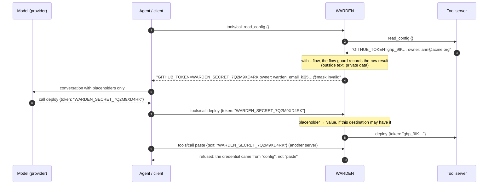
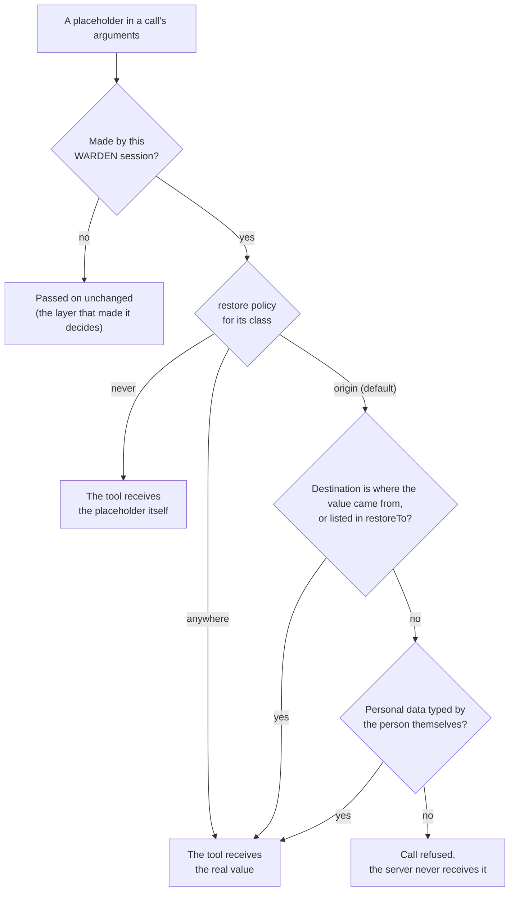
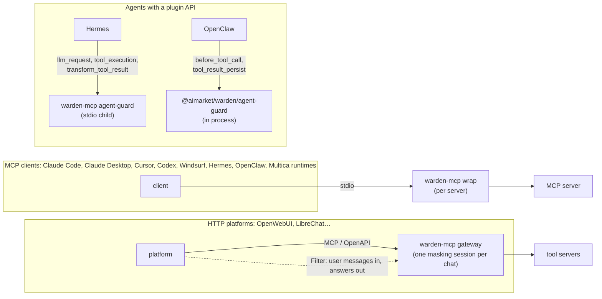

# Masking: keys and personal data stay out of the model

> 🌐 **English** · [Русский](masking.ru.md) · [Español](masking.es.md) · [Français](masking.fr.md) · [中文](masking.zh.md)

An agent reads a config file, a database row or a ticket, and everything it read goes to the model provider: a
deploy token, a customer's e-mail, an IBAN. WARDEN replaces those values with placeholders before the model reads them,
and puts the real values back when the model uses a placeholder in a tool call, only for a tool allowed to receive it.
The model can still act on a value; it never sees it.

- **Credentials: on by default.** API keys in known formats, private keys, JWTs, `Authorization` values, URL
  passwords, credential query parameters, values of fields named like `password` or `api_key`, and the credentials in
  WARDEN's own environment.
- **Personal data: off by default, one switch for organisations that need it** (GDPR, CCPA, 152-FZ, PCI DSS): e-mail
  addresses, phone numbers, payment cards, IBANs, public IP addresses, national ids, and the names and patterns the
  organisation lists.

Masking ships in WARDEN 0.37.0 (npm `@aimarket/warden@0.37.1`).

## How it works



The table that links a placeholder to its value stays in the WARDEN process's memory: never on disk, never in a log,
gone when the process ends. In the terms of the EDPB's [Guidelines 01/2025 on
pseudonymisation](https://www.edpb.europa.eu/our-work-tools/documents/public-consultations/2025/guidelines-012025-pseudonymisation_en),
the model, its provider and their logs form the *pseudonymisation domain*, and that table is the *additional
information* that must not enter it. Placeholders follow the guidelines' advice for pseudonyms:

- **Random.** 50 bits from the system CSPRNG, not a hash of the value. Nobody can compute a placeholder from a guess.
- **Empty of the value.** No first or last characters, unlike masks such as `sk-3f…a83`.
- **Stable within a session, different between sessions.** The model can tell that two results mention the same
  person; two sessions cannot be linked through their placeholders.

The format is `WARDEN_<KIND>_<ID>`, for example `WARDEN_SECRET_7Q2M9XD4RK`. The id is 10 characters of Crockford
base32. An e-mail address becomes `warden_email_<id>@mask.invalid`, so a field that must hold an address (JSON Schema
`format: email`) still does; `.invalid` is reserved by RFC 2606, so mail to it never leaves the machine. Placeholders
use only letters, digits, `_`, `@` and `.`, so they survive URLs, JSON, Markdown and shell commands unchanged.

### Where a placeholder may go



- **origin** (default): back to the server it came from. A key read from the `vault` server goes back to `vault`, not
  to `pastebin`, even if a prompt injection convinces the model to try. `restoreTo` lists more destinations, as
  `server` or `server/tool` with `*` globs.
- **anywhere**: any tool. Use it only for personal data inside one trusted system.
- **never**: pure redaction. The tool receives the placeholder text.
- **What the person typed** in the chat is theirs to use: their own personal data goes to any tool. A key they typed
  goes only where `restoreTo` says, the same rule the flow guard applies to a typed secret.
- **Unknown placeholders pass through**, so two WARDEN layers compose: a placeholder made by a gateway in front of a
  wrapped server is resolved by the layer that made it.

The flow guard still judges every call, and it judges the call as it will run, with the real values put back. In its
default policy a call that carries a recognised secret format is refused even to its origin: in the Hermes test below,
`printf %s <token> | sha256sum` was refused until the flow guard was turned off. Masking decides where a value may go;
the flow guard decides whether a call should run at all.

## Where it works



| Integration | What is masked | What is restored | Notes |
|---|---|---|---|
| `wrap` (any stdio MCP client) | Results of every wrapped server: tool results, errors, resources, prompts, completions, log and progress notifications, sampling requests | Call arguments, resource URIs, prompt arguments, completion values, sampling results | Default on for credentials. Built-in tools of the client (its own file read, shell) do not pass through `wrap` |
| `gateway`, MCP over HTTP | The same, per chat (`X-OpenWebUI-Chat-Id`) | Call arguments, read parameters | The header values the gateway sends to its servers are masked too |
| `gateway`, OpenAPI | The JSON result, keeping its shape | Path, query (URL-encoded) and body (re-written in RFC 8785 form) | |
| OpenWebUI Filter (`warden_filter.py`) | The person's messages and the chat history before the model (text parts only, images untouched); results of OpenWebUI's own tools | Arguments of OpenWebUI's own tools | `reveal_answers` shows the person their personal data again; `mask_fail_closed` keeps a message from the model when the gateway is down |
| Hermes plugin | **Everything the provider receives** (`llm_request`): messages, tool results, system prompt, memory; tool results again before they enter the session store | Tool arguments at execution (`tool_execution`), after approvals and guardrails saw the placeholder | Live-tested, see below |
| OpenClaw plugin | Tool results and messages as written to the transcript | Tool parameters (`before_tool_call`) | **Within one run the model sees the raw tool result**: OpenClaw 2026.11.6 has no hook that rewrites a result before the model reads it. Wrap MCP servers for in-run protection; the flow guard still refuses a secret leaving |
| Codex, Claude Code, Cursor, Multica | Through `wrap` for every MCP server | Through `wrap` | Their hook APIs cannot rewrite a built-in tool's output; the flow guard (Claude Code plugin, Codex hooks, OpenCode plugin) stops a secret leaving |
| Library | `new Masker(loadMaskConfig()).session(id).mask(value, {server, tool})` | `.restore(value, {server, tool})` | `@aimarket/warden/mask` |

## Turn it on or change it

Credentials are masked without any setting. Personal data needs one switch:

```bash
# one wrapped server
warden-mcp wrap --id crm --mask-personal gdpr -- npx -y my-crm-mcp
# every WARDEN process a client starts, without touching its config
export WARDEN_MASK_PERSONAL=gdpr
# off
warden-mcp wrap --id notes --mask-credentials off -- node notes.js
```

A JSON file (`--mask mask.json`, `WARDEN_MASK=/path/mask.json`, or the gateway config's `mask` field) holds the whole
policy. Unknown fields are an error:

```json
{
  "credentials": {
    "enabled": true,
    "restore": "origin",
    "restoreTo": ["deploy/*"],
    "exceptTools": ["vault/create_key"],
    "autoEnv": true,
    "envNames": ["STRIPE_KEY"]
  },
  "personal": {
    "enabled": true,
    "profile": "gdpr",
    "restore": "origin",
    "restoreTo": ["mail/send_*"],
    "terms": { "NAME": ["Ann Smith"], "CUSTOMER": ["ACME-77"] },
    "termsFile": "customers.txt",
    "patterns": [{ "kind": "CONTRACT", "pattern": "CTR-[0-9]{6}" }],
    "keep": ["@acme.org", "support@acme.org"],
    "privateIps": false
  },
  "display": { "credentials": false, "personal": true },
  "maxEntries": 10000,
  "idleMinutes": 1440
}
```

| Field | Meaning |
|---|---|
| `restore` | `origin` (default), `anywhere` or `never`, per class |
| `restoreTo` | More destinations: `server` or `server/tool`, `*` globs |
| `exceptTools` | Tools whose results are not masked, such as a tool that creates a key the person must copy |
| `autoEnv` | Mask the values of WARDEN's own environment variables named like credentials (`*_TOKEN`, `*_KEY`, `*PASSWORD`…). The client passes a server's keys in that environment, so a server that prints its own key is caught |
| `terms`, `termsFile` | Names, customer ids and other words the organisation lists: whole words, any case. A file has one term per line, `KIND: term` to set the kind |
| `patterns` | Regular expressions with their kind. Backreferences, lookarounds and nested quantifiers are refused: they can run for a long time on hostile text |
| `keep` | Values never masked: an exact value, or `@domain` for every address there |
| `display` | What `reveal` shows the person: personal data yes, credentials no (a transcript is copied, shared and sent to the model again) |
| `maxEntries`, `idleMinutes` | Bounds per session; the least recently used placeholder ages out and then passes as plain text |

Order of precedence: defaults, then the file (`--mask` or `WARDEN_MASK`), then `WARDEN_MASK_CREDENTIALS` and
`WARDEN_MASK_PERSONAL` (only without `--mask`, so a file the operator names is the whole policy), then the flags.

### Profiles

A profile picks detectors. It does not make processing lawful by itself, and pseudonymised data is still personal data
under the GDPR.

| Profile | For | Kinds |
|---|---|---|
| `gdpr` | EU/EEA GDPR, UK GDPR, Swiss FADP | EMAIL, PHONE (international form), CARD, IBAN, IP |
| `us` | CCPA/CPRA and similar US state laws | EMAIL, PHONE (international and NANP), CARD, SSN, IP |
| `ru-152fz` | Russian Federal Law 152-FZ | EMAIL, PHONE (international and `8 9xx`), CARD, SNILS, INN, IP |
| `pci` | PCI DSS scope reduction | CARD |
| `custom` | Only the organisation's terms and patterns | none built in |

### What is recognised, and how it is checked

| Kind | Check |
|---|---|
| SECRET | About 40 provider formats (GitHub, GitLab, AWS, OpenAI and Anthropic, Stripe, Slack, Google, Hugging Face, SendGrid, Twilio, DigitalOcean, Shopify, PyPI, npm, Docker Hub, Vault, Doppler, Grafana, Sentry, Atlassian, Telegram, Discord…); PEM private-key blocks; JWTs; `Authorization`/`Bearer` values; `scheme://user:password@`; `token=`, `api_key=`, `sig=`, `X-Amz-Signature=` and similar parameters; values of credential-named fields and assignments; WARDEN's credential environment values. A value another tool already redacted (`ghp_ab...9f3e`, `***`, `[REDACTED]`) is left alone |
| EMAIL | RFC 5321 shape; `example.com/.org/.net`, `.example`, `.invalid`, `.test`, `.localhost` are skipped (RFC 2606, RFC 6761) |
| PHONE | `+` or `00` and 8–15 digits (ITU-T E.164); national forms only in the `us` and `ru-152fz` profiles |
| CARD | 12–19 digits, an issuer range of a network in use (ISO/IEC 7812) and the Luhn check |
| IBAN | Country length table and the mod-97 check (ISO 13616) |
| IP | Public IPv4 and IPv6; loopback, private, link-local, CGNAT and documentation ranges are skipped unless `privateIps` (IP addresses are personal data under the CJEU's *Breyer* judgment, C-582/14) |
| SSN, SNILS, INN | Format plus the number's own rules or checksum |

Names and street addresses need a language model to find. WARDEN does not guess them; it masks the names the
organisation lists. Every detector is bounded: a test runs all of them over a megabyte of hostile text in under three
seconds.

## Hermes and OpenClaw

Both agents run their file, shell and web tools inside their own process, so `wrap` only sees their MCP servers. The
npm package carries a plugin for each under `integrations/`. Both were installed and run on real agents: Hermes 0.19.0
on a production host and OpenClaw 2026.11.6 in a throwaway container (what each run showed is under
[Checked](#checked)).

### Hermes

```bash
npm install -g @aimarket/warden@0.37.1
cp -r "$(npm root -g)/@aimarket/warden/integrations/hermes/warden" ~/.hermes/plugins/warden
hermes plugins enable warden
systemctl restart hermes-gateway     # or start hermes again
```

The plugin starts one `warden-mcp agent-guard` child and keeps the placeholder table there; `WARDEN_AGENT_GUARD_CMD`
names another command. Settings go to `~/.hermes/.env`: `WARDEN_MASK_PERSONAL=gdpr`, `WARDEN_MASK=/path/mask.json`,
`WARDEN_HERMES_FLOW=off` (masking stays on), `WARDEN_STATE_DIR`.

| Hermes seam | What WARDEN does there |
|---|---|
| `llm_request` | Masks everything the provider receives: the person's messages, tool results, the system prompt, memory |
| `tool_execution` | Puts values back when the tool runs, after Hermes' approval prompt and its command patterns saw only the placeholder |
| `transform_tool_result` | Masks a result before it enters the session store |
| `pre_tool_call`, `post_tool_call` | The flow guard; its `ask` becomes Hermes' own approval prompt |
| `transform_llm_output` | Shows the person their personal data again (credentials stay masked) |

What is specific to Hermes:

- **Its own redaction is one way.** `security.redact_secrets` (on by default) cuts known token formats inside
  `read_file` to `ghp_ng...39e5`, so a placeholder can only bring back the cut string. Keep it if the agent never needs
  to use a secret; set it to `false` to let WARDEN mask reversibly.
- **Origins.** The file and shell tools are one place, `local`; the web and browser tools are `web`; each MCP server is
  `mcp:<server>`. A key read from a local file can go into a shell command; the same placeholder in a `web_extract` URL
  stops the call.
- **Fail-closed.** If the `agent-guard` child stops and cannot be restarted, the plugin withholds tool results and
  refuses calls that carry a placeholder.
- `WARDEN_HERMES_DEBUG=1` logs the method, session and tool name of each request, never a value.

### OpenClaw

```bash
npm install -g @aimarket/warden@0.37.1
cp -r "$(npm root -g)/@aimarket/warden/integrations/openclaw/warden" ~/openclaw-warden
cd ~/openclaw-warden && npm install --omit=dev
sudo chown -R root:root .
openclaw plugins install --link "$PWD" --force --accept-capabilities
openclaw plugins enable warden
```

Then restart the OpenClaw Gateway. The plugin runs inside the Gateway process with WARDEN's library
(`@aimarket/warden/agent-guard`), so there is no child process. Settings: `plugins.entries.warden.config` in
`openclaw.json` (`personal`, `maskConfig`, `flowGuard`), or the `WARDEN_MASK*` environment; `WARDEN_OPENCLAW_FLOW=off`
turns the flow guard off and `WARDEN_OPENCLAW_DEBUG=1` traces the hooks.

| OpenClaw hook | What WARDEN does there |
|---|---|
| `before_tool_call` | Puts values back in the parameters; the flow guard blocks the call or asks through OpenClaw's own approval |
| `after_tool_call` | The flow guard records what the result brought into the session |
| `tool_result_persist`, `before_message_write` | Masks results and messages as they are stored and replayed |
| `message_sending` | Shows the person their personal data again |

What is specific to OpenClaw:

- **The model reads a raw result within the run that produced it.** OpenClaw 2026.11.6 has no hook that rewrites a tool
  result before the model reads it; `tool_result_persist` changes only what is stored. Later turns and the transcript
  get placeholders. For protection inside a run, put MCP servers behind `wrap`; the flow guard still refuses a call
  that carries a secret.
- **Plugin files must belong to root.** Otherwise OpenClaw refuses the plugin ("suspicious ownership"). Installing it
  needs `--accept-capabilities`.
- **Hooks run in the Gateway.** `openclaw agent exec` runs one embedded turn without the Gateway and did not call
  plugin hooks in our test; run agents through the Gateway.

## What the model is told

The first masked result of a session carries one note, after the content:

> [WARDEN] 1 SECRET in this result was replaced by placeholders such as WARDEN_SECRET_7Q2M9XD4RK or
> warden_email_…@mask.invalid. You can still use a masked value: write its placeholder, exactly as shown, where the
> value belongs in a tool call (a command, a header, a field). The tool receives the real value if it may have it (by
> default: the place the value came from); otherwise WARDEN refuses the call and says why. You never need to see the
> value, so do not guess, reconstruct or ask for it.

Later results carry one short line. In the Hermes test, an earlier wording ("do not try to guess or ask for the hidden
values") made DeepSeek conclude it could not use the token at all; the current wording says what to do.

## Checked

- **Unit and protocol tests** (`npm test`): detectors with their checksums and false-positive cases, hostile-input
  timing, restore rules, the `wrap` proxy with a real child server (default credentials, `--mask-personal`, the
  environment switch, `restore: never`, errors, `--audit-only`), the gateway over MCP and OpenAPI with per-chat
  sessions and the `/v1` routes, `agent-guard` as a stdio service. The OpenWebUI adapter tests
  (`python3 -m unittest`), the Hermes plugin against the real `agent-guard`, and the OpenClaw plugin with a stand-in API.
- **Hermes 0.19.0 on a live host, 2026-11-22**, model `deepseek/deepseek-chat` through OpenRouter. A file held a random
  `ghp_` token. The session store holds `GITHUB_TOKEN=WARDEN_SECRET_CG4G9F0HM4`, never the token. The model ran
  `printf %s WARDEN_SECRET_CG4G9F0HM4 | sha256sum`, and the shell printed the SHA-256 of the real token
  (`c7b5d520…3251`, equal to the hash computed beside the file). With the flow guard on, the same call was refused:
  "this call carries a secret (GitHub token)".
- **Hermes' own redaction.** With `security.redact_secrets: true` (Hermes' default), `read_file` already returns
  `ghp_ng...39e5`: one way, so a placeholder can only bring back the redacted string. Keep Hermes' redaction if the
  agent never needs to use a secret; turn it off to let WARDEN mask reversibly.
- **OpenClaw 2026.11.6** in a throwaway container: with the plugin loaded through the Gateway, the transcript and the
  session database hold only the placeholder, and the flow guard refused `exec` with the token. The model
  still read the raw file within the run (see the table above).

## Limits

- Only what passes through WARDEN is masked: a client's built-in tools (Claude Code's `Read`, Codex's shell) are not,
  and neither is text the person pastes into a client that WARDEN does not front.
- In OpenClaw the model sees a raw tool result within the run that produced it.
- Detection is pattern-based. A key in a format WARDEN does not know, in a field whose name does not say so, passes.
  Personal data beyond the listed kinds (names, addresses, free-text health data) needs `terms` and `patterns`.
- The model can still reason about a value's *kind* and context ("the token for the deploy server"). Masking hides
  values, not facts around them.
- Restore puts the exact value in the exact place the model wrote the placeholder. A value written into a file through
  the server it came from lands on disk. That is usually the point, and the flow guard judges it like any write.
- A restart of WARDEN forgets every placeholder; old ones then pass as plain text and no call can turn them into values.
- Logs record kinds and counts (`masked SECRET×1 in read_config`), never values; gateway chat logs record the same.
