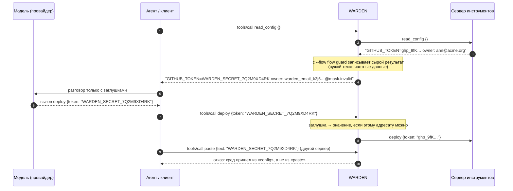
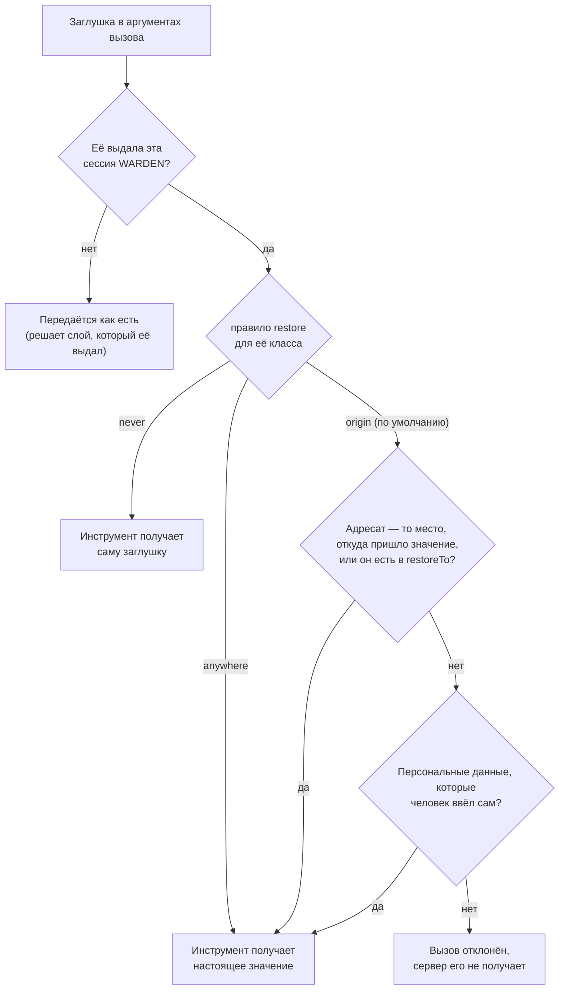
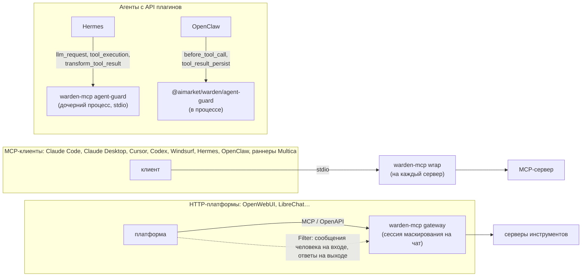

# Маскирование: ключи и персональные данные не попадают в модель

> 🌐 [English](masking.md) · **Русский** · [Español](masking.es.md) · [Français](masking.fr.md) · [中文](masking.zh.md)

Агент читает файл конфигурации, строку базы или тикет, и всё прочитанное уходит провайдеру модели: токен деплоя,
адрес клиента, IBAN. WARDEN заменяет такие значения заглушками до того, как их прочтёт модель, и возвращает настоящие
значения, когда модель подставляет заглушку в вызов инструмента, — только тому инструменту, которому значение можно
передать. Модель может действовать со значением, но никогда его не видит.

- **Креды: включено по умолчанию.** API-ключи известных форматов, приватные ключи, JWT, значения `Authorization`,
  пароли в URL, параметры запроса с кредами, значения полей с именами вроде `password` или `api_key` и креды из
  окружения самого WARDEN.
- **Персональные данные: выключено по умолчанию, один переключатель для организаций, которым это нужно** (GDPR, CCPA,
  152-ФЗ, PCI DSS): адреса e-mail, телефоны, банковские карты, IBAN, публичные IP-адреса, национальные номера, а также
  имена и шаблоны из списка организации.

Маскирование входит в WARDEN 0.37.0 (npm `@aimarket/warden@0.39.2`).

## Как это работает



Таблица, связывающая заглушку со значением, живёт только в памяти процесса WARDEN: не на диске, не в логах, исчезает
вместе с процессом. В терминах [Руководства EDPB 01/2025 о
псевдонимизации](https://www.edpb.europa.eu/our-work-tools/documents/public-consultations/2025/guidelines-012025-pseudonymisation_en)
модель, её провайдер и их логи — *домен псевдонимизации*, а эта таблица — *дополнительная информация*, которая не
должна в него попасть. Заглушки следуют советам руководства о псевдонимах:

- **Случайные.** 50 бит из системного CSPRNG, а не хеш значения. Заглушку нельзя вычислить по догадке.
- **Без частей значения.** Ни первых, ни последних символов, в отличие от масок вроде `sk-3f…a83`.
- **Стабильные в сессии, разные между сессиями.** Модель понимает, что два результата говорят об одном человеке;
  две сессии нельзя связать по их заглушкам.

Формат — `WARDEN_<ВИД>_<ID>`, например `WARDEN_SECRET_7Q2M9XD4RK`; id — 10 символов Crockford base32. Адрес e-mail
превращается в `warden_email_<id>@mask.invalid`, поэтому поле, где должен быть адрес (JSON Schema `format: email`),
остаётся корректным; домен `.invalid` зарезервирован RFC 2606, письмо на него никуда не уйдёт. В заглушках только
буквы, цифры, `_`, `@` и `.`: они без изменений проходят через URL, JSON, Markdown и команды оболочки.

### Куда может пойти заглушка



- **origin** (по умолчанию): обратно на сервер, откуда значение пришло. Ключ, прочитанный с сервера `vault`, вернётся
  в `vault`, но не в `pastebin`, даже если инъекция в промпте уговорит модель попробовать. `restoreTo` добавляет
  адресатов: `server` или `server/tool`, с `*`.
- **anywhere**: любой инструмент. Только для персональных данных внутри одной доверенной системы.
- **never**: чистая редакция. Инструмент получает текст заглушки.
- **То, что человек сам написал** в чате, — его: его персональные данные идут в любой инструмент. Ключ, который он
  ввёл, идёт только туда, куда указывает `restoreTo`, — то же правило, что у flow guard для введённого секрета.
- **Незнакомые заглушки проходят как есть**, поэтому два слоя WARDEN совместимы: заглушку, выданную шлюзом перед
  обёрнутым сервером, разрешает тот слой, который её выдал.

Flow guard по-прежнему оценивает каждый вызов — в том виде, в каком он выполнится, с подставленными значениями. В его
политике по умолчанию вызов, несущий секрет узнаваемого формата, отклоняется даже в сторону источника: в тесте Hermes
ниже `printf %s <токен> | sha256sum` отклонялся, пока flow guard не выключили. Маскирование решает, куда значению
можно; flow guard — выполнять ли вызов вообще.

## Где это работает



| Интеграция | Что маскируется | Что восстанавливается | Замечания |
|---|---|---|---|
| `wrap` (любой stdio MCP-клиент) | Всё, что отдаёт обёрнутый сервер: результаты инструментов, ошибки, ресурсы, промпты, автодополнения, уведомления логов и прогресса, запросы sampling | Аргументы вызовов, URI ресурсов, аргументы промптов, значения автодополнения, результаты sampling | Креды — по умолчанию. Встроенные инструменты клиента (его собственное чтение файлов, shell) через `wrap` не проходят |
| `gateway`, MCP по HTTP | То же, отдельно для каждого чата (`X-OpenWebUI-Chat-Id`) | Аргументы вызовов, параметры чтения | Значения заголовков, которые шлюз отправляет своим серверам, тоже маскируются |
| `gateway`, OpenAPI | JSON-результат, с сохранением формы | Путь, query (в URL-кодировке) и тело (заново в форме RFC 8785) | |
| Фильтр OpenWebUI (`warden_filter.py`) | Сообщения человека и история чата перед моделью (только текст, картинки не трогаются); результаты собственных инструментов OpenWebUI | Аргументы собственных инструментов OpenWebUI | `reveal_answers` показывает человеку его персональные данные; `mask_fail_closed` не отдаёт сообщение модели, если шлюз недоступен |
| Плагин Hermes | **Всё, что получает провайдер** (`llm_request`): сообщения, результаты инструментов, системный промпт, память; результаты инструментов ещё раз — до записи в хранилище сессий | Аргументы инструментов при выполнении (`tool_execution`), после того как подтверждения и проверки увидели заглушку | Проверено вживую, см. ниже |
| Плагин OpenClaw | Результаты инструментов и сообщения при записи в стенограмму | Параметры инструментов (`before_tool_call`) | **Внутри одного прогона модель видит сырой результат**: в OpenClaw 2026.11.6 нет хука, который переписывает результат до модели. Для защиты внутри прогона оборачивайте MCP-серверы; flow guard по-прежнему не выпускает секрет наружу |
| Codex, Claude Code, Cursor, Multica | Через `wrap` для каждого MCP-сервера | Через `wrap` | Их API хуков не умеют переписывать вывод встроенных инструментов; flow guard (плагин Claude Code, хуки Codex, плагин OpenCode) останавливает утечку секрета |
| Библиотека | `new Masker(loadMaskConfig()).session(id).mask(value, {server, tool})` | `.restore(value, {server, tool})` | `@aimarket/warden/mask` |

## Как включить или изменить

Креды маскируются без настроек. Для персональных данных нужен один переключатель:

```bash
# один обёрнутый сервер
warden-mcp wrap --id crm --mask-personal gdpr -- npx -y my-crm-mcp
# каждый процесс WARDEN, который запускает клиент, без правки его конфигурации
export WARDEN_MASK_PERSONAL=gdpr
# выключить
warden-mcp wrap --id notes --mask-credentials off -- node notes.js
```

Вся политика — в JSON-файле (`--mask mask.json`, `WARDEN_MASK=/path/mask.json` или поле `mask` в конфиге шлюза).
Неизвестные поля — ошибка:

```json
{
  "credentials": {
    "enabled": true,
    "restore": "origin",
    "restoreTo": ["deploy/*"],
    "exceptTools": ["vault/create_key"],
    "autoEnv": true,
    "envNames": ["STRIPE_KEY"]
  },
  "personal": {
    "enabled": true,
    "profile": "gdpr",
    "restore": "origin",
    "restoreTo": ["mail/send_*"],
    "terms": { "NAME": ["Ann Smith"], "CUSTOMER": ["ACME-77"] },
    "termsFile": "customers.txt",
    "patterns": [{ "kind": "CONTRACT", "pattern": "CTR-[0-9]{6}" }],
    "keep": ["@acme.org", "support@acme.org"],
    "privateIps": false
  },
  "display": { "credentials": false, "personal": true },
  "maxEntries": 10000,
  "idleMinutes": 1440
}
```

| Поле | Смысл |
|---|---|
| `restore` | `origin` (по умолчанию), `anywhere` или `never`, отдельно для каждого класса |
| `restoreTo` | Дополнительные адресаты: `server` или `server/tool`, с `*` |
| `exceptTools` | Инструменты, результаты которых не маскируются, — например, тот, что создаёт ключ, который человек должен скопировать |
| `autoEnv` | Маскировать значения переменных окружения WARDEN с именами кредов (`*_TOKEN`, `*_KEY`, `*PASSWORD`…). Клиент передаёт серверу ключи через это окружение, поэтому сервер, напечатавший свой ключ, будет пойман |
| `terms`, `termsFile` | Имена, номера клиентов и другие слова из списка организации: целые слова, без учёта регистра. В файле по одному термину на строку, `ВИД: термин` задаёт вид |
| `patterns` | Регулярные выражения с видом. Обратные ссылки, lookaround и вложенные квантификаторы запрещены: на враждебном тексте они могут работать очень долго |
| `keep` | Значения, которые не маскируются никогда: точное значение или `@домен` для всех адресов на нём |
| `display` | Что `reveal` показывает человеку: персональные данные да, креды нет (стенограмму копируют, пересылают и снова отправляют модели) |
| `maxEntries`, `idleMinutes` | Ограничения на сессию; давно не использованная заглушка вытесняется и дальше проходит как обычный текст |

Порядок приоритета: значения по умолчанию, затем файл (`--mask` или `WARDEN_MASK`), затем `WARDEN_MASK_CREDENTIALS` и
`WARDEN_MASK_PERSONAL` (только без `--mask`: файл, указанный оператором, — это вся политика), затем флаги.

### Профили

Профиль выбирает детекторы. Сам по себе он не делает обработку законной, а псевдонимизированные данные по GDPR
остаются персональными.

| Профиль | Для | Виды |
|---|---|---|
| `gdpr` | GDPR ЕС/ЕЭЗ, UK GDPR, швейцарский FADP | EMAIL, PHONE (международный формат), CARD, IBAN, IP |
| `us` | CCPA/CPRA и похожие законы штатов США | EMAIL, PHONE (международный и NANP), CARD, SSN, IP |
| `ru-152fz` | Федеральный закон 152-ФЗ | EMAIL, PHONE (международный и `8 9xx`), CARD, СНИЛС, ИНН, IP |
| `pci` | Сужение области PCI DSS | CARD |
| `custom` | Только термины и шаблоны организации | встроенных нет |

### Что распознаётся и как проверяется

| Вид | Проверка |
|---|---|
| SECRET | Около 40 форматов провайдеров (GitHub, GitLab, AWS, OpenAI и Anthropic, Stripe, Slack, Google, Hugging Face, SendGrid, Twilio, DigitalOcean, Shopify, PyPI, npm, Docker Hub, Vault, Doppler, Grafana, Sentry, Atlassian, Telegram, Discord…); PEM-блоки приватных ключей; JWT; значения `Authorization`/`Bearer`; `scheme://user:password@`; параметры `token=`, `api_key=`, `sig=`, `X-Amz-Signature=` и подобные; значения полей и присваиваний с именами кредов; значения кредов из окружения WARDEN. Значение, которое другой инструмент уже отредактировал (`ghp_ab...9f3e`, `***`, `[REDACTED]`), не трогается |
| EMAIL | Форма по RFC 5321; `example.com/.org/.net`, `.example`, `.invalid`, `.test`, `.localhost` пропускаются (RFC 2606, RFC 6761) |
| PHONE | `+` или `00` и 8–15 цифр (ITU-T E.164); национальные форматы — только в профилях `us` и `ru-152fz` |
| CARD | 12–19 цифр, диапазон эмитента действующей сети (ISO/IEC 7812) и проверка Луна |
| IBAN | Таблица длин по странам и проверка mod-97 (ISO 13616) |
| IP | Публичные IPv4 и IPv6; loopback, частные, link-local, CGNAT и документационные диапазоны пропускаются, если не задан `privateIps` (IP-адреса — персональные данные по решению Суда ЕС *Breyer*, C-582/14) |
| SSN, СНИЛС, ИНН | Формат плюс собственные правила или контрольная сумма номера |

Имена и почтовые адреса без языковой модели не найти. WARDEN их не угадывает, а маскирует имена из списка
организации. Каждый детектор ограничен по времени: тест прогоняет все детекторы по мегабайту враждебного текста меньше
чем за три секунды.

## Hermes и OpenClaw

Оба агента выполняют свои файловые, shell- и веб-инструменты внутри собственного процесса, поэтому `wrap` видит только
их MCP-серверы. В npm-пакете для каждого есть плагин в `integrations/`. Оба установлены и проверены на настоящих
агентах: Hermes 0.19.0 на рабочем сервере и OpenClaw 2026.11.6 во временном контейнере (что показал каждый прогон — в
разделе [Что проверено](#что-проверено)).

### Hermes

```bash
npm install -g @aimarket/warden@0.39.2
cp -r "$(npm root -g)/@aimarket/warden/integrations/hermes/warden" ~/.hermes/plugins/warden
hermes plugins enable warden
systemctl restart hermes-gateway     # или запустите hermes заново
```

Плагин запускает один дочерний процесс `warden-mcp agent-guard`, и таблица заглушек живёт в нём; другую команду задаёт
`WARDEN_AGENT_GUARD_CMD`. Настройки — в `~/.hermes/.env`: `WARDEN_MASK_PERSONAL=gdpr`, `WARDEN_MASK=/path/mask.json`,
`WARDEN_HERMES_FLOW=off` (маскирование остаётся включённым), `WARDEN_STATE_DIR`.

| Точка Hermes | Что там делает WARDEN |
|---|---|
| `llm_request` | Маскирует всё, что получает провайдер: сообщения человека, результаты инструментов, системный промпт, память |
| `tool_execution` | Возвращает значения в момент запуска инструмента, когда окно подтверждения Hermes и его шаблоны опасных команд уже видели только заглушку |
| `transform_tool_result` | Маскирует результат до того, как он попадёт в хранилище сессий |
| `pre_tool_call`, `post_tool_call` | Flow guard; его `ask` становится собственным окном подтверждения Hermes |
| `transform_llm_output` | Показывает человеку его персональные данные (креды остаются замаскированными) |

Особенности Hermes:

- **Его собственная редакция односторонняя.** `security.redact_secrets` (включена по умолчанию) обрезает известные
  форматы токенов внутри `read_file` до `ghp_ng...39e5`, и заглушка может вернуть только обрезанную строку. Оставьте её,
  если агенту никогда не нужно пользоваться секретом; поставьте `false`, чтобы WARDEN маскировал обратимо.
- **Источники.** Файловые и shell-инструменты — одно место, `local`; веб- и браузерные — `web`; каждый MCP-сервер —
  `mcp:<server>`. Ключ, прочитанный из локального файла, может пойти в shell-команду; та же заглушка в URL для
  `web_extract` останавливает вызов.
- **Отказ по умолчанию.** Если дочерний `agent-guard` упал и не перезапускается, плагин не отдаёт модели результаты
  инструментов и отклоняет вызовы с заглушками.
- `WARDEN_HERMES_DEBUG=1` пишет в лог метод, сессию и имя инструмента каждого запроса, но никогда не значения.

### OpenClaw

```bash
npm install -g @aimarket/warden@0.39.2
cp -r "$(npm root -g)/@aimarket/warden/integrations/openclaw/warden" ~/openclaw-warden
cd ~/openclaw-warden && npm install --omit=dev
sudo chown -R root:root .
openclaw plugins install --link "$PWD" --force --accept-capabilities
openclaw plugins enable warden
```

Затем перезапустите Gateway OpenClaw. Плагин работает внутри процесса Gateway на библиотеке WARDEN
(`@aimarket/warden/agent-guard`), дочернего процесса нет. Настройки: `plugins.entries.warden.config` в `openclaw.json`
(`personal`, `maskConfig`, `flowGuard`) или переменные `WARDEN_MASK*`; `WARDEN_OPENCLAW_FLOW=off` выключает flow
guard, `WARDEN_OPENCLAW_DEBUG=1` трассирует хуки.

| Хук OpenClaw | Что там делает WARDEN |
|---|---|
| `before_tool_call` | Возвращает значения в параметры; flow guard блокирует вызов или спрашивает через собственное подтверждение OpenClaw |
| `after_tool_call` | Flow guard записывает, что результат принёс в сессию |
| `tool_result_persist`, `before_message_write` | Маскирует результаты и сообщения при сохранении и повторной отправке |
| `message_sending` | Показывает человеку его персональные данные |

Особенности OpenClaw:

- **Внутри хода, который получил результат, модель читает его сырым.** В OpenClaw 2026.11.6 нет хука, который
  переписывает результат инструмента до того, как его прочтёт модель; `tool_result_persist` меняет только то, что
  сохраняется. Следующие ходы и стенограмма получают заглушки. Для защиты внутри хода поставьте MCP-серверы за `wrap`;
  flow guard по-прежнему отклоняет вызов, который несёт секрет.
- **Файлы плагина должны принадлежать root.** Иначе OpenClaw отказывается его загружать («suspicious ownership»).
  Установка требует `--accept-capabilities`.
- **Хуки работают в Gateway.** `openclaw agent exec` выполняет один встроенный ход без Gateway и в нашем тесте не
  вызывал хуки плагина; запускайте агентов через Gateway.

## Что сообщается модели

Первый замаскированный результат в сессии несёт одну заметку после содержимого:

> [WARDEN] 1 SECRET in this result was replaced by placeholders such as WARDEN_SECRET_7Q2M9XD4RK or
> warden_email_…@mask.invalid. You can still use a masked value: write its placeholder, exactly as shown, where the
> value belongs in a tool call (a command, a header, a field). The tool receives the real value if it may have it (by
> default: the place the value came from); otherwise WARDEN refuses the call and says why. You never need to see the
> value, so do not guess, reconstruct or ask for it.

Дальше — одна короткая строка. В тесте Hermes прежняя формулировка («не пытайся угадать или запросить скрытые
значения») привела DeepSeek к выводу, что токеном вообще нельзя пользоваться; нынешняя говорит, что делать.

## Что проверено

- **Модульные и протокольные тесты** (`npm test`): детекторы с контрольными суммами и ложными срабатываниями, время на
  враждебном входе, правила восстановления, прокси `wrap` с настоящим дочерним сервером (креды по умолчанию,
  `--mask-personal`, переключатель окружения, `restore: never`, ошибки, `--audit-only`), шлюз по MCP и OpenAPI с
  сессиями на чат и маршруты `/v1`, `agent-guard` как stdio-сервис. Тесты адаптера OpenWebUI (`python3 -m unittest`),
  плагин Hermes против настоящего `agent-guard` и плагин OpenClaw с подменённым API.
- **Hermes 0.19.0 на живом хосте, 22.11.2026**, модель `deepseek/deepseek-chat` через OpenRouter. В файле лежал
  случайный токен `ghp_`. В хранилище сессий записано `GITHUB_TOKEN=WARDEN_SECRET_CG4G9F0HM4`, токена нет. Модель
  выполнила `printf %s WARDEN_SECRET_CG4G9F0HM4 | sha256sum`, и оболочка напечатала SHA-256 настоящего токена
  (`c7b5d520…3251`, совпадает с хешем, посчитанным рядом с файлом). С включённым flow guard тот же вызов отклонён:
  «this call carries a secret (GitHub token)».
- **Собственная редакция Hermes.** При `security.redact_secrets: true` (так по умолчанию в Hermes) `read_file` уже
  возвращает `ghp_ng...39e5`: в одну сторону, поэтому заглушка может вернуть только урезанную строку. Оставьте
  редакцию Hermes, если агенту никогда не нужно пользоваться секретами; выключите её, чтобы WARDEN маскировал обратимо.
- **OpenClaw 2026.11.6** во временном контейнере: с плагином, загруженным через Gateway, в стенограмме и базе сессий
  только заглушка, а flow guard отклонил `exec` с токеном. Внутри прогона модель всё же прочла сырой файл (см. таблицу
  выше).

## Ограничения

- Маскируется только то, что проходит через WARDEN: встроенные инструменты клиента (`Read` в Claude Code, shell в
  Codex) — нет, и текст, который человек вставляет в клиент без WARDEN впереди, — тоже нет.
- В OpenClaw модель видит сырой результат инструмента внутри прогона, который его получил.
- Распознавание — по шаблонам. Ключ незнакомого формата в поле, имя которого об этом не говорит, пройдёт.
  Персональные данные за пределами перечисленных видов (имена, адреса, медицинские сведения в свободном тексте)
  требуют `terms` и `patterns`.
- Модель всё ещё может рассуждать о *виде* значения и контексте («токен для сервера деплоя»). Маскирование скрывает
  значения, а не факты вокруг них.
- Восстановление ставит точное значение ровно туда, куда модель написала заглушку. Значение, записанное в файл через
  сервер, откуда оно пришло, окажется на диске. Обычно это и нужно, и flow guard оценивает это как любую запись.
- Перезапуск WARDEN забывает все заглушки; старые дальше идут как обычный текст, и никакой вызов не превратит их в
  значения.
- В логах — виды и количества (`masked SECRET×1 in read_config`), никогда не значения; журналы чатов шлюза пишут то
  же самое.
