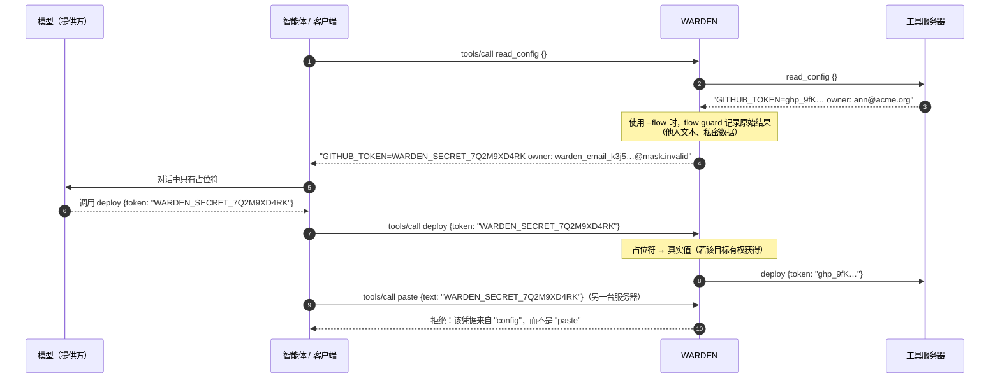
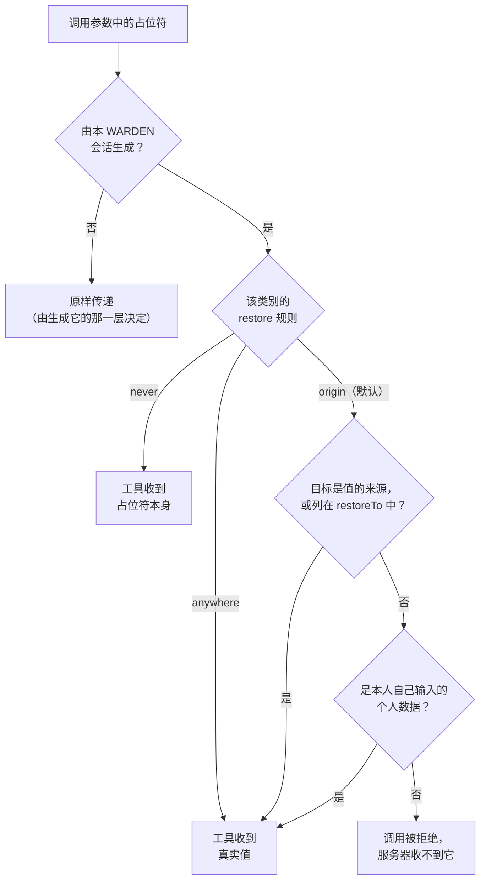
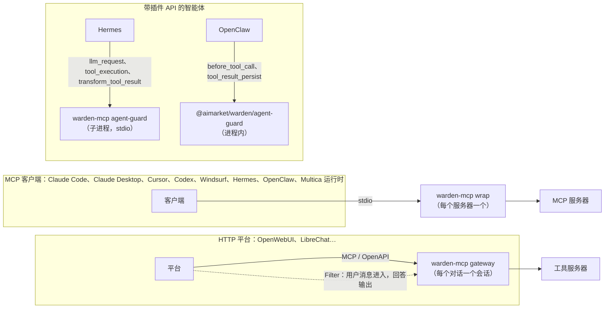

# 脱敏：密钥和个人数据不进入模型

> 🌐 [English](masking.md) · [Русский](masking.ru.md) · [Español](masking.es.md) · [Français](masking.fr.md) · **中文**

智能体读取配置文件、数据库中的一行或一张工单时，它读到的所有内容都会发给模型提供方：部署令牌、客户的邮箱、IBAN。
WARDEN 在模型读取之前把这些值替换为占位符；当模型在工具调用中使用占位符时，WARDEN 再把真实值放回去，但只针对允许接收该值的工具。
模型可以使用一个值来完成操作，却始终看不到它。

- **凭据：默认开启。** 已知格式的 API 密钥、私钥、JWT、`Authorization` 的值、URL 中的密码、携带凭据的查询参数、
  名为 `password`、`api_key` 之类字段的值，以及 WARDEN 自身环境中的凭据。
- **个人数据：默认关闭，需要的组织只需打开一个开关**（GDPR、CCPA、152-FZ、PCI DSS）：电子邮件地址、电话号码、
  支付卡号、IBAN、公网 IP 地址、国家证件号码，以及组织列出的名称和模式。

脱敏功能随 WARDEN 0.37.0 发布（npm `@aimarket/warden@0.38.1`）。

## 工作原理



把占位符和值对应起来的表只存在于 WARDEN 进程的内存中：不写盘，不进日志，进程结束即消失。按照
[EDPB 关于假名化的 01/2025 指南](https://www.edpb.europa.eu/our-work-tools/documents/public-consultations/2025/guidelines-012025-pseudonymisation_en)
的术语，模型、其提供方及其日志构成*假名化域*，而这张表就是不得进入该域的*附加信息*。占位符遵循指南对假名的建议：

- **随机。** 来自系统 CSPRNG 的 50 位，而不是值的哈希。无法通过猜测计算出占位符。
- **不含值的任何部分。** 不保留首尾字符，不同于 `sk-3f…a83` 这类掩码。
- **会话内稳定，会话之间不同。** 模型能分辨两个结果提到的是同一个人；两个会话无法通过占位符关联起来。

格式为 `WARDEN_<类型>_<ID>`，例如 `WARDEN_SECRET_7Q2M9XD4RK`；ID 是 10 个 Crockford base32 字符。电子邮件地址变为
`warden_email_<id>@mask.invalid`，因此必须填写地址的字段（JSON Schema `format: email`）依然有效；`.invalid` 由
RFC 2606 保留，发往该域的邮件不会离开本机。占位符只使用字母、数字、`_`、`@` 和 `.`，在 URL、JSON、Markdown 和
shell 命令中都能原样保留。

### 占位符可以去哪里



- **origin**（默认）：回到值所来自的服务器。从 `vault` 服务器读到的密钥会回到 `vault`，而不会去 `pastebin`，
  即使提示词注入说服模型去尝试。`restoreTo` 可增加目标：`server` 或 `server/tool`，支持 `*`。
- **anywhere**：任何工具。仅用于同一个可信系统内的个人数据。
- **never**：纯粹的遮蔽。工具收到的是占位符文本。
- **本人在对话中输入的内容**归本人所用：其个人数据可交给任何工具。本人输入的密钥只能去 `restoreTo` 指定之处，
  与 flow guard 对待输入的密钥的规则相同。
- **未知占位符原样通过**，因此两层 WARDEN 可以叠加：由包裹服务器之前的网关生成的占位符，由生成它的那一层解析。

flow guard 仍然评估每一次调用，而且是按调用实际执行时的样子、即放回真实值之后来评估。在其默认策略下，携带可识别格式密钥的调用即使发往来源也会被拒绝：
在下文的 Hermes 测试中，`printf %s <令牌> | sha256sum` 一直被拒绝，直到关闭 flow guard。脱敏决定一个值可以去哪里；flow guard 决定一个调用是否应当执行。

## 适用范围



| 集成方式 | 脱敏对象 | 还原对象 | 说明 |
|---|---|---|---|
| `wrap`（任何 stdio MCP 客户端） | 被包裹服务器返回的一切：工具结果、错误、资源、提示词、补全、日志与进度通知、sampling 请求 | 调用参数、资源 URI、提示词参数、补全值、sampling 结果 | 凭据默认开启。客户端的内置工具（它自己的读文件、shell）不经过 `wrap` |
| `gateway`，基于 HTTP 的 MCP | 同上，按对话区分（`X-OpenWebUI-Chat-Id`） | 调用参数、读取参数 | 网关发给其服务器的请求头值同样会被脱敏 |
| `gateway`，OpenAPI | JSON 结果，保持原有结构 | 路径、query（URL 编码）和请求体（以 RFC 8785 形式重写） | |
| OpenWebUI Filter（`warden_filter.py`） | 发给模型之前的用户消息和对话历史（仅文本，图片不动）；OpenWebUI 自带工具的结果 | OpenWebUI 自带工具的参数 | `reveal_answers` 向本人显示其个人数据；`mask_fail_closed` 在网关不可用时不把消息发给模型 |
| Hermes 插件 | **提供方收到的一切**（`llm_request`）：消息、工具结果、系统提示词、记忆；工具结果在写入会话存储前再处理一次 | 执行时的工具参数（`tool_execution`），审批和防护检查看到的仍是占位符 | 已在线上实测，见下文 |
| OpenClaw 插件 | 写入对话记录时的工具结果和消息 | 工具参数（`before_tool_call`） | **在一次运行内，模型会看到原始工具结果**：OpenClaw 2026.11.6 没有在模型读取前改写结果的钩子。需要运行内保护时请用 `wrap` 包裹 MCP 服务器；flow guard 仍会阻止密钥外泄 |
| Codex、Claude Code、Cursor、Multica | 通过 `wrap` 处理每个 MCP 服务器 | 通过 `wrap` | 它们的钩子 API 无法改写内置工具的输出；flow guard（Claude Code 插件、Codex 钩子、OpenCode 插件）阻止密钥外泄 |
| 库 | `new Masker(loadMaskConfig()).session(id).mask(value, {server, tool})` | `.restore(value, {server, tool})` | `@aimarket/warden/mask` |

## 开启或调整

凭据无需任何设置即会脱敏。个人数据只需一个开关：

```bash
# 单个被包裹的服务器
warden-mcp wrap --id crm --mask-personal gdpr -- npx -y my-crm-mcp
# 客户端启动的每个 WARDEN 进程，无需改动其配置
export WARDEN_MASK_PERSONAL=gdpr
# 关闭
warden-mcp wrap --id notes --mask-credentials off -- node notes.js
```

一个 JSON 文件（`--mask mask.json`、`WARDEN_MASK=/path/mask.json` 或网关配置中的 `mask` 字段）承载完整策略。未知字段视为错误：

```json
{
  "credentials": {
    "enabled": true,
    "restore": "origin",
    "restoreTo": ["deploy/*"],
    "exceptTools": ["vault/create_key"],
    "autoEnv": true,
    "envNames": ["STRIPE_KEY"]
  },
  "personal": {
    "enabled": true,
    "profile": "gdpr",
    "restore": "origin",
    "restoreTo": ["mail/send_*"],
    "terms": { "NAME": ["Ann Smith"], "CUSTOMER": ["ACME-77"] },
    "termsFile": "customers.txt",
    "patterns": [{ "kind": "CONTRACT", "pattern": "CTR-[0-9]{6}" }],
    "keep": ["@acme.org", "support@acme.org"],
    "privateIps": false
  },
  "display": { "credentials": false, "personal": true },
  "maxEntries": 10000,
  "idleMinutes": 1440
}
```

| 字段 | 含义 |
|---|---|
| `restore` | `origin`（默认）、`anywhere` 或 `never`，按类别设置 |
| `restoreTo` | 更多目标：`server` 或 `server/tool`，支持 `*` |
| `exceptTools` | 结果不做脱敏的工具，例如创建一个需要本人复制的密钥的工具 |
| `autoEnv` | 对 WARDEN 自身环境中名称像凭据的变量（`*_TOKEN`、`*_KEY`、`*PASSWORD`…）的值做脱敏。客户端通过该环境把密钥传给服务器，因此打印自己密钥的服务器会被发现 |
| `terms`、`termsFile` | 组织列出的姓名、客户编号等词语：整词匹配，不区分大小写。文件每行一个词，`类型: 词` 指定类型 |
| `patterns` | 带类型的正则表达式。拒绝反向引用、环视和嵌套量词：它们在恶意文本上可能运行很久 |
| `keep` | 永不脱敏的值：精确值，或 `@域名` 表示该域名下的所有地址 |
| `display` | `reveal` 向本人显示的内容：个人数据显示，凭据不显示（对话记录会被复制、分享并再次发给模型） |
| `maxEntries`、`idleMinutes` | 每个会话的上限；最久未用的占位符会被淘汰，之后作为普通文本通过 |

优先级顺序：默认值，然后是文件（`--mask` 或 `WARDEN_MASK`），然后是 `WARDEN_MASK_CREDENTIALS` 和
`WARDEN_MASK_PERSONAL`（仅在未指定 `--mask` 时生效：运营方指定的文件即完整策略），最后是命令行参数。

### 配置档

配置档用于选择检测器。它本身并不能使处理合法；按照 GDPR，假名化数据仍然是个人数据。

| 配置档 | 适用于 | 类型 |
|---|---|---|
| `gdpr` | 欧盟/欧洲经济区 GDPR、英国 GDPR、瑞士 FADP | EMAIL、PHONE（国际格式）、CARD、IBAN、IP |
| `us` | CCPA/CPRA 及美国各州类似法律 | EMAIL、PHONE（国际格式和 NANP）、CARD、SSN、IP |
| `ru-152fz` | 俄罗斯联邦第 152-FZ 号法律 | EMAIL、PHONE（国际格式和 `8 9xx`）、CARD、SNILS、INN、IP |
| `pci` | 缩小 PCI DSS 范围 | CARD |
| `custom` | 只用组织的词语和模式 | 无内置 |

### 识别内容与校验方式

| 类型 | 校验 |
|---|---|
| SECRET | 约 40 种提供方格式（GitHub、GitLab、AWS、OpenAI 和 Anthropic、Stripe、Slack、Google、Hugging Face、SendGrid、Twilio、DigitalOcean、Shopify、PyPI、npm、Docker Hub、Vault、Doppler、Grafana、Sentry、Atlassian、Telegram、Discord…）；PEM 私钥块；JWT；`Authorization`/`Bearer` 的值；`scheme://user:password@`；`token=`、`api_key=`、`sig=`、`X-Amz-Signature=` 等参数；以凭据命名的字段和赋值的值；WARDEN 环境中的凭据值。其他工具已遮蔽过的值（`ghp_ab...9f3e`、`***`、`[REDACTED]`）不做处理 |
| EMAIL | 符合 RFC 5321 的形式；跳过 `example.com/.org/.net`、`.example`、`.invalid`、`.test`、`.localhost`（RFC 2606、RFC 6761） |
| PHONE | `+` 或 `00` 加 8–15 位数字（ITU-T E.164）；国内格式仅在 `us` 和 `ru-152fz` 配置档中识别 |
| CARD | 12–19 位数字、在用卡组织的发卡机构号段（ISO/IEC 7812）以及 Luhn 校验 |
| IBAN | 各国长度表和 mod-97 校验（ISO 13616） |
| IP | 公网 IPv4 和 IPv6；除非设置 `privateIps`，否则跳过环回、私有、链路本地、CGNAT 和文档用地址段（根据欧盟法院 *Breyer* 案判决 C-582/14，IP 地址属于个人数据） |
| SSN、SNILS、INN | 格式加上号码自身的规则或校验和 |

姓名和街道地址需要语言模型才能找出。WARDEN 不去猜测，而是对组织列出的名称做脱敏。每个检测器都有界：
一项测试在一兆字节的恶意文本上运行全部检测器，用时不到三秒。

## Hermes 与 OpenClaw

这两个智能体都在自己的进程内运行文件、shell 和网页工具，因此 `wrap` 只能看到它们的 MCP 服务器。npm 包在 `integrations/`
下为两者各带一个插件。两者都在真实智能体上安装并运行过：生产服务器上的 Hermes 0.19.0，以及一次性容器中的 OpenClaw
2026.11.6（每次运行的结果见[已验证](#已验证)）。

### Hermes

```bash
npm install -g @aimarket/warden@0.38.1
cp -r "$(npm root -g)/@aimarket/warden/integrations/hermes/warden" ~/.hermes/plugins/warden
hermes plugins enable warden
systemctl restart hermes-gateway     # 或重新启动 hermes
```

插件启动一个 `warden-mcp agent-guard` 子进程，占位符表保存在其中；`WARDEN_AGENT_GUARD_CMD` 可指定其他命令。设置写在
`~/.hermes/.env`：`WARDEN_MASK_PERSONAL=gdpr`、`WARDEN_MASK=/path/mask.json`、`WARDEN_HERMES_FLOW=off`（脱敏仍然开启）、
`WARDEN_STATE_DIR`。

| Hermes 接入点 | WARDEN 在此做什么 |
|---|---|
| `llm_request` | 脱敏提供方收到的全部内容：用户消息、工具结果、系统提示词、记忆 |
| `tool_execution` | 在工具运行时放回真实值；此前 Hermes 的审批提示和危险命令规则只看到占位符 |
| `transform_tool_result` | 在结果进入会话存储之前脱敏 |
| `pre_tool_call`、`post_tool_call` | 流向防护（flow guard）；其 `ask` 会变成 Hermes 自己的审批提示 |
| `transform_llm_output` | 让用户在回答中重新看到自己的个人数据（凭据保持脱敏） |

Hermes 的特点：

- **它自带的遮蔽是单向的。** `security.redact_secrets`（默认开启）会在 `read_file` 中把已知令牌格式截成
  `ghp_ng...39e5`，占位符只能还原出截断后的字符串。如果智能体从不需要使用密钥，就保留它；设为 `false`，WARDEN
  才能可逆地脱敏。
- **来源。** 文件和 shell 工具属于同一个地方 `local`；网页和浏览器工具属于 `web`；每个 MCP 服务器为
  `mcp:<server>`。从本地文件读到的密钥可以进入 shell 命令；同一个占位符出现在 `web_extract` 的 URL 中，调用会被拦下。
- **失败即关闭。** 如果 `agent-guard` 子进程停止且无法重启，插件会扣下工具结果，并拒绝携带占位符的调用。
- `WARDEN_HERMES_DEBUG=1` 只记录每个请求的方法、会话和工具名，从不记录值。

### OpenClaw

```bash
npm install -g @aimarket/warden@0.38.1
cp -r "$(npm root -g)/@aimarket/warden/integrations/openclaw/warden" ~/openclaw-warden
cd ~/openclaw-warden && npm install --omit=dev
sudo chown -R root:root .
openclaw plugins install --link "$PWD" --force --accept-capabilities
openclaw plugins enable warden
```

然后重启 OpenClaw Gateway。插件在 Gateway 进程内通过 WARDEN 的库（`@aimarket/warden/agent-guard`）运行，没有子进程。
设置：`openclaw.json` 中的 `plugins.entries.warden.config`（`personal`、`maskConfig`、`flowGuard`），或 `WARDEN_MASK*`
环境变量；`WARDEN_OPENCLAW_FLOW=off` 关闭流向防护，`WARDEN_OPENCLAW_DEBUG=1` 跟踪各个钩子。

| OpenClaw 钩子 | WARDEN 在此做什么 |
|---|---|
| `before_tool_call` | 把真实值放回参数；流向防护拦截调用，或通过 OpenClaw 自己的审批询问 |
| `after_tool_call` | 流向防护记录结果给会话带来了什么 |
| `tool_result_persist`、`before_message_write` | 在保存和重放时脱敏结果与消息 |
| `message_sending` | 让用户重新看到自己的个人数据 |

OpenClaw 的特点：

- **在产生结果的那一轮里，模型读到的是原始结果。** OpenClaw 2026.11.6 没有能在模型读取之前改写工具结果的钩子；
  `tool_result_persist` 只改变保存的内容。之后的轮次和对话记录拿到的是占位符。若要在一轮之内也受保护，请把 MCP
  服务器放在 `wrap` 之后；流向防护仍会拒绝携带密钥的调用。
- **插件文件必须属于 root。** 否则 OpenClaw 拒绝加载插件（"suspicious ownership"）。安装需要 `--accept-capabilities`。
- **钩子在 Gateway 中运行。** `openclaw agent exec` 不经 Gateway 运行一轮内嵌对话，在我们的测试中没有调用插件钩子；
  请通过 Gateway 运行智能体。

## 告诉模型的内容

会话中第一个被脱敏的结果会在内容之后附带一条说明：

> [WARDEN] 1 SECRET in this result was replaced by placeholders such as WARDEN_SECRET_7Q2M9XD4RK or
> warden_email_…@mask.invalid. You can still use a masked value: write its placeholder, exactly as shown, where the
> value belongs in a tool call (a command, a header, a field). The tool receives the real value if it may have it (by
> default: the place the value came from); otherwise WARDEN refuses the call and says why. You never need to see the
> value, so do not guess, reconstruct or ask for it.

之后的结果只附带一行简短说明。在 Hermes 测试中，早先的措辞（"不要尝试猜测或索要被隐藏的值"）让 DeepSeek
认为根本不能使用该令牌；现在的措辞说明了应该怎么做。

## 已验证

- **单元与协议测试**（`npm test`）：检测器及其校验和与误报用例、恶意输入下的耗时、还原规则、带真实子服务器的
  `wrap` 代理（默认凭据、`--mask-personal`、环境变量开关、`restore: never`、错误、`--audit-only`）、基于 MCP 和
  OpenAPI 的网关（按对话的会话）以及 `/v1` 路由、作为 stdio 服务的 `agent-guard`。OpenWebUI 适配器测试
  （`python3 -m unittest`）、针对真实 `agent-guard` 的 Hermes 插件测试，以及使用模拟 API 的 OpenClaw 插件测试。
- **Hermes 0.19.0，线上主机，2026-11-22**，模型 `deepseek/deepseek-chat`，经 OpenRouter。文件中有一个随机的
  `ghp_` 令牌。会话存储中记录的是 `GITHUB_TOKEN=WARDEN_SECRET_CG4G9F0HM4`，从未出现令牌本身。模型执行了
  `printf %s WARDEN_SECRET_CG4G9F0HM4 | sha256sum`，shell 输出的是真实令牌的 SHA-256（`c7b5d520…3251`，与在文件旁计算的哈希一致）。
  开启 flow guard 时，同一调用被拒绝："this call carries a secret (GitHub token)"。
- **Hermes 自带的遮蔽。** 当 `security.redact_secrets: true`（Hermes 默认值）时，`read_file` 已返回
  `ghp_ng...39e5`：这是单向的，占位符只能还原出被截断的字符串。如果智能体从不需要使用密钥，可保留 Hermes 的遮蔽；
  如需让 WARDEN 进行可逆脱敏，请将其关闭。
- **OpenClaw 2026.11.6**，在一次性容器中：插件经 Gateway 加载后，对话记录和会话数据库中只有占位符，flow guard 拒绝了携带令牌的 `exec`。
  但在运行过程中，模型仍读到了原始文件（见上表）。

## 局限

- 只有经过 WARDEN 的内容才会被脱敏：客户端的内置工具（Claude Code 的 `Read`、Codex 的 shell）不会，用户粘贴到前面没有 WARDEN 的客户端中的文本也不会。
- 在 OpenClaw 中，模型会在产生某个工具结果的那次运行内看到原始结果。
- 检测基于模式。WARDEN 不认识的格式的密钥、放在名称未表明其用途的字段中，会被放过。超出所列类型的个人数据（姓名、地址、自由文本中的健康数据）需要 `terms` 和 `patterns`。
- 模型仍能推断一个值的*类型*和上下文（"部署服务器的令牌"）。脱敏隐藏的是值，而不是值周围的事实。
- 还原会把确切的值放到模型写占位符的确切位置。通过值的来源服务器写入文件的值会落到磁盘上。这通常正是目的所在，flow guard 会像对待任何写入一样评估它。
- WARDEN 重启后会忘记所有占位符；旧的占位符之后作为普通文本通过，任何调用都无法再把它们变回值。
- 日志只记录类型和数量（`masked SECRET×1 in read_config`），从不记录值；网关的对话日志也是如此。
